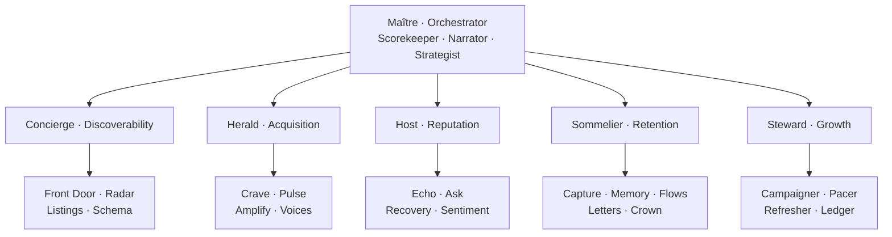
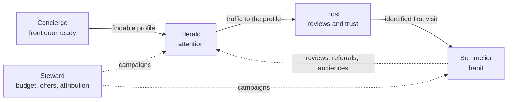

# One orchestrator, *five named engines*

Each engine of the Growth System becomes an agent with a name, a character and rules of its own. Maître coordinates; Concierge, Herald, Host, Sommelier and Steward work the guest's complete journey, each with its own team of subagents.

| Agent | Engine | Mission | Attitude | Subagents |
| --- | --- | --- | --- | --- |
| [Maître](./maitre) | Orchestrator (all five) | Sees the whole room and decides where the next hour and the next dollar go | Calm, analytical, direct | 3 |
| [Concierge](./concierge) | Discoverability | Makes the digital front door answer every question in under 10 seconds | Precise, tidy, reassuring | 4 |
| [Herald](./herald) | Acquisition | Puts the restaurant on the mental shortlist before hunger strikes | Curious, tireless, tasteful | 4 |
| [Host](./host) | Reputation | Guards the door: whoever compares chooses us | Warm, precise, protective | 4 |
| [Sommelier](./sommelier) | Retention | Remembers every guest and gives them a reason to return | Attentive, patient, discreet | 5 |
| [Steward](./steward) | Growth | Turns spend into tracked revenue | Frugal, exact, candid | 4 |

6 agents and 24 subagents: 30 in total.

## How they work together

Each agent hands off to the next at a specific moment of the journey, always through events. None depends on another existing in order to work.

## Agents grade practice, Maître scores

Each engine's observing subagents write the weekly **practice grades** (0–4) that make up 40% of the engine score: Radar and Schema (Discoverability), Pulse (Acquisition), Sentiment and Echo (Reputation), Memory and Flows (Retention), Pacer and Refresher (Growth). Scorekeeper blends them with the measured half. See [Metrics and Growth Score](../system/metrics).

## What gets built first

Scorekeeper and the data pipeline come first, because every other agent reads the score. The first autonomous subagents are Echo, Ask and Scorekeeper. See [Plan](../plan).
