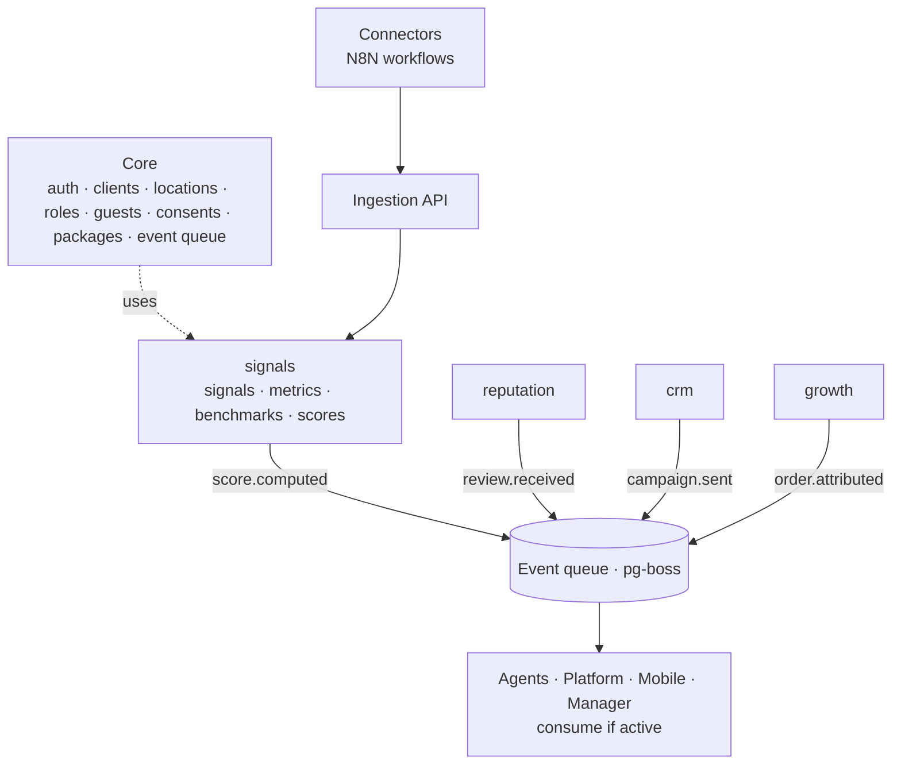

# A modular monolith, *not microservices*

A single deployable system, divided into modules that do not know each other. It is the simplest way to operate with a small team, and each module can be split into its own service the day it is needed without rewriting it.

## The six independence rules

| # | Rule | What it means |
| --- | --- | --- |
| 1 | **Own tables** | Each module has its own schema in Postgres. None reads or writes another module's tables. They use Core's public API, and read metrics only through the `signals` module's read API |
| 2 | **Own entry points** | Every module works without depending on another: the CRM with a CSV import, the reputation module with a QR and manual send |
| 3 | **Only events between modules** | A module publishes facts (`review.received`). Whoever wants them consumes them. If nobody listens, nothing happens |
| 4 | **Versioned contracts** | Each event has a Zod schema with a version in `@atrium/contracts`. Changing a contract means a new version |
| 5 | **Switched on per client** | Each module is activated per client and per location with a feature flag derived from the package |
| 6 | **Tests itself** | Each module passes its tests without any other existing; integrations are tested against the contract |

A CI rule (dependency-cruiser) breaks the build if a module imports another's code. Independence does not depend on discipline.

## One data model

Every number any surface shows resolves to a metric built from daily signals. Integrations are not an afterthought: Toast, Metricool, Resend, Google, Meta and the first-party hub are the sources the system exists to read. A manual log keeps every metric alive when a connector is missing. See [Data](../data).

## Agents with verifiable limits

Agents act only through MCP tools that expose the same use cases as the interface, with a policy engine in between. See [Agents and MCP](./agents-and-mcp).
