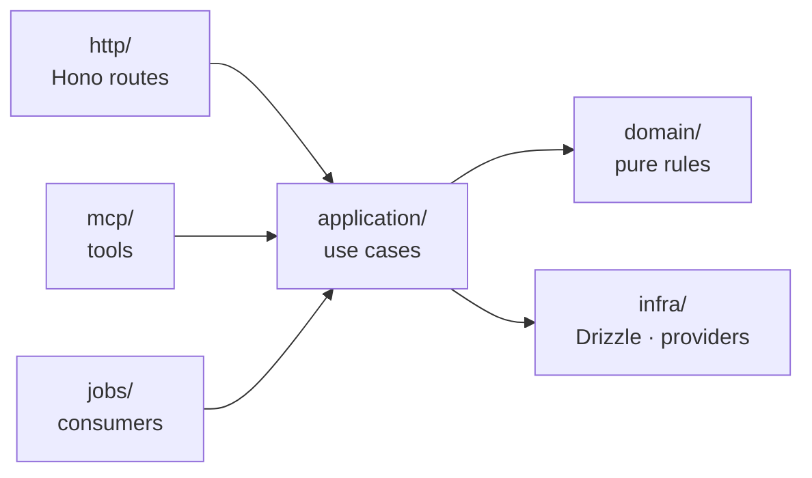

# Repository and *shape of a module*

```text
atrium/
├─ apps/
│  ├─ platform/       # Next.js 16 · the client's dashboard (Growth OS)
│  ├─ manager/        # Next.js 16 · the agency's app (Agency OS)
│  ├─ hub/            # Next.js 16 · landing hub, survey flow, public pages
│  ├─ mobile/         # Expo · the owner app
│  ├─ api/            # Hono · mounts each module's routes, ingestion API
│  ├─ worker/         # pg-boss · events, rollups, scoring, sends
│  ├─ agents/         # agent runtime + MCP gateway
│  └─ docs/           # this documentation (Docusaurus)
├─ connectors/        # N8N workflow exports, one folder per provider
├─ modules/
│  ├─ core/           # auth, clients, locations, guests, consents, packages
│  ├─ signals/        # signals, metrics, benchmarks, scores
│  │  ├─ domain/          # pure rules, no IO
│  │  ├─ application/     # use cases
│  │  ├─ infra/           # Drizzle, providers
│  │  ├─ http/            # Hono routes
│  │  ├─ jobs/            # event consumers, rollups
│  │  ├─ mcp/             # tools for agents
│  │  ├─ agents/          # subagent manifests
│  │  ├─ migrations/
│  │  └─ tests/
│  ├─ discoverability/ # setup readiness, listings, hub buttons, site health
│  ├─ reputation/     # reviews, replies, survey flow, recovery cases
│  ├─ crm/            # guestbook, segments, automations, campaigns, loyalty
│  ├─ growth/         # programs, offers, campaigns, attribution
│  ├─ content/        # elements registry, pipeline, calendar, approvals
│  ├─ ops/            # tasks, COG, cycles, daily entry
│  ├─ reports/        # report builder, narrative, archive
│  └─ booker/         # deferred: reservations
├─ packages/
│  ├─ contracts/      # events and DTOs with Zod
│  ├─ scoring/        # pure functions: normalization, blends, Growth Score
│  ├─ policy/         # agent policy engine
│  ├─ ui/             # Base UI + Tailwind + brand tokens
│  ├─ email/          # React Email templates
│  └─ config/         # tsconfig, biome, dependency rules
└─ docs/adr/          # copy of the ADRs in the repo
```

## Layers of a module



| Layer | May import | May not import |
| --- | --- | --- |
| `domain/` | Nothing outside itself, `packages/contracts` and `packages/scoring` | Database, network, framework |
| `application/` | `domain/`, `infra/` interfaces, public APIs of `core` and `signals` | Other modules |
| `infra/` | `domain/`, Drizzle, provider SDKs | Other modules |
| `http/`, `mcp/`, `jobs/` | `application/` | `infra/` directly, other modules |

:::tip One logic, three doors
The interface (`http/`), the agents (`mcp/`) and the events (`jobs/`) call the same use cases. An agent can never do something that a person with that role cannot.
:::

## Database rules

- Every query goes through a repository that requires the `client_id`; RLS in Postgres is the second defense.
- Every important technical decision is recorded in an [ADR](../adr).
- Nothing reaches `main` without review, green CI and tested migrations. See [Definition of done](../guides/definition-of-done).
