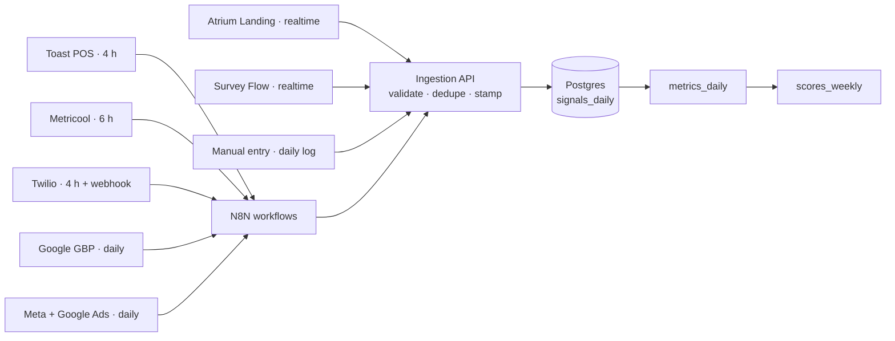

# Storage and *the pipe*

Six tables in one Postgres. Everything lands in `signals_daily`; everything else is built from it.

## Tables

| Table | Grain | Columns | Notes |
| --- | --- | --- | --- |
| `signals_daily` | 1 row / signal / day | `date`, `location_id`, `source`, `platform`, `element_id?`, `signal_type`, `value`, `meta`, `guest_id?` | The atom. Everything lands here: connectors, webhooks rolled up nightly, manual entries, agent grades |
| `metrics_daily` | 1 row / metric / day | `date`, `location_id`, `metric_id`, `value`, `engine`, `funnel_stage` | Built rollups from `signals_daily`: what every screen reads. Rebuilt idempotently; never edited by hand |
| `elements` | 1 row / element | `element_id`, `type`, `platform`, `title`, `status`, `published_at`, `offer_id?` | The registry of individual pieces: posts, emails, ads, offers, hub buttons. Signals join on `element_id` |
| `benchmarks_monthly` | 1 row / metric / month | `month`, `metric_id`, `radius_value`, `sample_size` | 10-mile radius averages. Nullable: a metric without a benchmark still renders, just without the amber tick |
| `agent_grades` | 1 row / criterion / week | `week`, `engine`, `criterion`, `grade` (0–4), `agent_id`, `evidence` | The qualitative half. Written only by agents; the Account Manager can override with a note |
| `scores_weekly` | 1 row / engine / week | `week`, `location_id`, `engine`, `measured`, `practice`, `score`, `bench_score` | Blended 60/40 per engine, plus the composite Growth Score row (`engine = all`) |

All tables carry `client_id` and are covered by the isolation tests. `signals_daily` is partitioned by month.

## Connectors

Connectors move data from each provider into `signals_daily`.

| Connector | Brings | Cadence |
| --- | --- | --- |
| Toast POS | Orders, revenue, guests, subscribers, menu performance | every 4 h |
| Metricool | All social platforms plus paid social and search | every 6 h |
| Twilio | Email, SMS and automations | 4 h + webhook |
| Google GBP | Profile actions, reviews, local rank | daily |
| Atrium Landing | Hub sessions and every button tap, tagged by source | realtime |
| Survey Flow | Post-order scores, QR opt-ins | realtime |
| Manual entry | Orders, catering leads, RSVPs the Account Manager logs by hand | daily log |

N8N workflows are the connector layer, and they never write to the database directly: they call a validated, idempotent ingestion API, so tenant isolation, schema validation and dedupe live in one place. See [ADR 0014](../adr/0014-n8n-connectors-with-ingestion-api). Ingestion is idempotent on the natural key (`date`, `location_id`, `source`, `platform`, `element_id`, `signal_type`); a re-run replaces the day.

## Identity stitching

Overlaps are resolved by identity stitching: pixel ID, POS match and phone or email join every signal, so one guest is counted once across every source. A QR scan and the order it led to are the same guest and are never double counted. Manual entries land in the same table, timestamped and tagged `source = manual`.

## Attribution methods

Every attributed dollar carries its method, stored in `meta`.

| Method | How the match is made | Confidence |
| --- | --- | --- |
| `code` | A promo or offer code redeemed at the POS | Verified |
| `pixel` | Ad click and order on the website or online ordering | Verified |
| `loyalty` | Loyalty phone or email on the check | Verified |
| `card` | Card match against the POS | Matched |
| `estimate` | Matched on-premise orders × average ticket | Estimated, always labeled |
| `manual` | Logged by hand by the Account Manager | As logged |

## Attribution views

Channel → funnel stage → outcome, "every action traced to the channel that earned it", in counts rather than dollars. Three table options replace the ribbon chart; the build chooses one after a review with clients.

| Option | Shape | Reads as |
| --- | --- | --- |
| 1a Heatmap matrix | One row per channel, one column per stage; tint is volume | Where each channel does its work |
| 1b Segmented bars with an outcome rail | One bar per channel split by stage; outcomes stacked on the right | How much of each channel becomes what |
| 1c Stage leaderboards | Four ranked columns: who wins each stage and what it became | Who to double down on, per stage |
