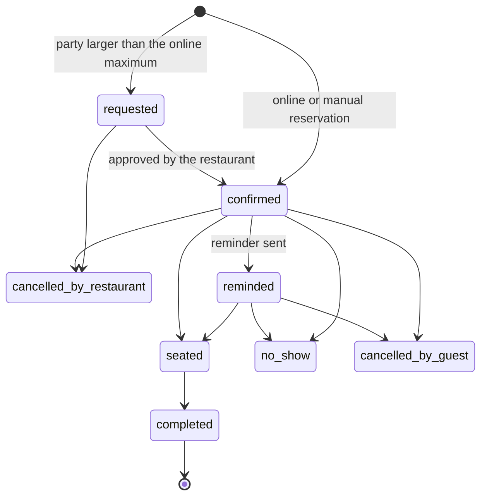

# Booker: reservations by *cover pacing*

:::note Deferred
The first release tracks reservations through reserve clicks and UTM links, and attributes the visits that follow. An own booking engine is not part of the current plan. The design is kept here so that it can be added on top of the same model. See [ADR 0012](../adr/0012-own-reservations-by-covers).
:::

The deferred module controls how many people come in every 15 minutes, not which table they occupy, and leaves the table map for later.

## Location configuration

| Parameter | Example |
| --- | --- |
| Hours per day and shifts | Lunch 12:00–15:00, dinner 18:00–22:30 |
| Interval | 15 min |
| Maximum covers per interval | 16 |
| Duration by party size | 1–2: 75 min · 3–4: 90 min · 5–8: 120 min |
| Capacity open online | 70% |
| Minimum notice / maximum window | 2 h / 30 days |
| Maximum online party size | 8 (larger → request) |

## Availability engine

Pure logic in `domain/`: given a location, a date and a party size, it returns the intervals with free covers, taking into account the party's duration, the online capacity and existing reservations. The first step of design is to fix whether the cap is on arrivals per interval or on covers seated at once; the example numbers above are not a decision.

:::warning Never oversold
The reservation is inserted in a transaction with a lock per location and date, and every submission carries an idempotency key. A load test with 50 simultaneous reservations for the last interval must end with 0 oversells.
:::

## Statuses

## When it is built

It would feed the `reservation` outcome signals directly, which today come from reserve clicks and the POS. It would use the same hub button and the same survey flow.
