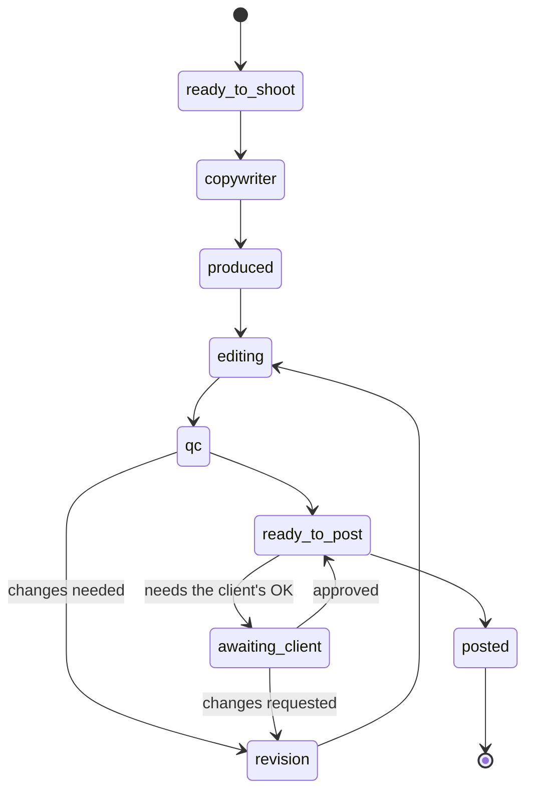

# Content: *the creative is the element*

Content is fulfillment and it is also data: every post, reel and email is an element whose signals attribute to that specific piece.

## Responsibilities

| Area | What it includes |
| --- | --- |
| Elements registry | One row per element: type, platform, title, status, publish date and offer; signals join on `element_id` |
| Pipeline | Eight statuses from Ready to Shoot to Posted, each with an owner; format, origin (cycle, extra, request), label and its time ceiling |
| Calendar | Posting calendar, ready to post, batch timelines for graphics and reels, daily pending |
| Approvals | The client's approval queue: approve, request changes; an approved piece goes to the calendar |
| Library | Every piece in one place with its metric |

## States

## MCP tools

| Tool | Writes | Initial level |
| --- | --- | --- |
| `content.list_calendar` | No | 4 |
| `content.draft_item` | Yes (a draft) | 2 |
| `content.propose_calendar` | Yes (a proposal) | 2 |
| `content.publish_item` | Yes | 3 |

## Events

**Publishes:** `content.status.changed`, `content.approved`, `content.published`.
**Consumes:** `task.fired`.
