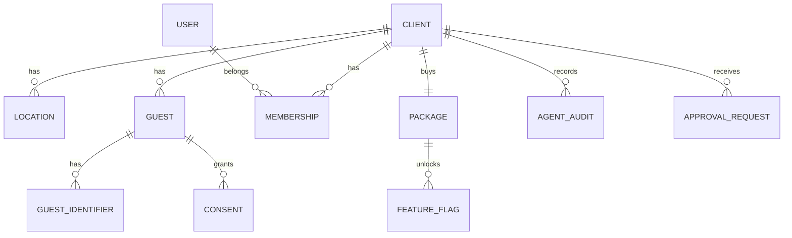

# Core, the only *shared* module

Core contains what every module needs and nothing more. The other modules use its public API; never its tables.

## Responsibilities

| Area | What it includes |
| --- | --- |
| Identity | Users, organizations, roles, team roles, invitations (Better Auth) |
| Tenancy | Clients, locations, time zone, brand (logo, colors), the 10-mile radius definition |
| Packages | The client's package and the access matrix, published as feature flags per module and per location |
| Guests | A single identity per client; email and phone normalized; deduplication; the identifiers used by identity stitching |
| Consents | Per channel (`email`) and purpose (`transactional`, `marketing`), with date, source and opt-out |
| Event queue | Transactional publishing with pg-boss; consumer registry |
| Notifications | Sending transactional email through Resend, with a plain-text outbox and delivery statuses |
| Agents | Audit log, approval queue, kill switches |

## Entities

## Public API (for other modules)

| Function | Purpose |
| --- | --- |
| `resolveGuest(clientId, {email?, phone?, name?})` | Returns the `guestId`, creating it if it does not exist |
| `canContact(guestId, channel, purpose)` | Verifies consent before any send |
| `recordConsent(guestId, channel, purpose, source)` | Records a consent or an opt-out, with its opt-in source |
| `publish(event, tx)` | Enqueues an event inside the caller's transaction |
| `isEnabled(clientId, locationId, module)` | Queries a feature flag, derived from the package |
| `requestApproval(clientId, item)` | Puts a proposal in the approval queue |
| `sendNotification(template, to, data)` | Sends a transactional message |

## Notifications

Email is the only channel. It is sent through Resend behind the `NotificationTransport` port ([ADR 0021](../adr/0021-resend-email-no-sms)). The Resend transport posts to Resend's REST API with an idempotency key. A 4xx answer is recorded as a `failed` delivery; a 429, a 5xx, a timeout or a network failure throws, so the caller retries.

- **Outbox.** Every send is recorded in `core.notifications` with the masked address and the plain text only, never HTML.
- **Statuses.** `recorded`, `sent`, `failed`, `delivered`, `bounced`, `complained`. A status never moves backwards. Opens and clicks are not tracked yet.
- **Webhook.** Resend calls `POST /webhooks/resend`. The request is verified with its Svix signature (5-minute tolerance, 256 KB body limit) and updates the status of the notification.
- **Consent.** A permanent bounce or a complaint withdraws that guest's email consent (sources `email_bounce` and `email_complaint`). The opt-out runs before the status moves. Transient or undetermined bounces change nothing.
- **Transport.** It is built from `RESEND_API_KEY` and `EMAIL_FROM`. The development transport, which records and sends nothing, exists only in development and test. Outside them the API and the agents service refuse to start without the Resend variables. The API also needs `RESEND_WEBHOOK_SECRET`; the agents service also needs `PUBLIC_BASE_URL`, `AGENTS_SERVICE_TOKEN` (32 characters or more) and the same unsubscribe secret as the API (`SURVEY_SECRET`, falling back to `BETTER_AUTH_SECRET`).
