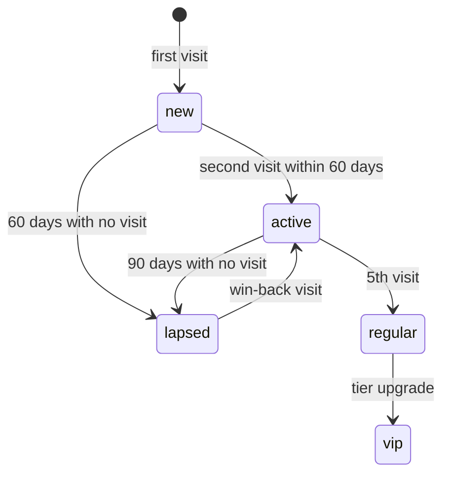

# CRM: *the owned relationship*

The module behind the Retention engine: the guestbook, the segments, the always-on automations, the campaigns and the loyalty program, over Twilio for email and SMS and Toast for the guest and the visit.

## Responsibilities

| Area | What it includes |
| --- | --- |
| Capture | Opt-ins from the POS, the WiFi captive portal, the QR survey, online-order and reservation checkouts; each contact keeps its origin |
| Guestbook | One profile per guest with visits, lifetime value, tag and last visit, from the Toast CRM |
| Segments | Regulars, lapsed, VIP, new, birthdays, by opt-in source |
| Automations | 24 h welcome, birthday, 60-day win-back, 90-day lapsed |
| Campaigns | Email (2–4 a month) and SMS (1–2 a month plus flash offers), segmented, with revenue windows of 14 days for email and 7 days for SMS |
| Loyalty | Visit-based tiers, VIP recognition and the 5-visit milestone |
| Cohorts | Retention by month since first visit |

## Rules in code

- `canContact` is checked on every send; SMS is capped at 2 per week per subscriber.
- Every message carries an opt-out; an opt-out is a signal and updates the consent log at once.
- SMS requires an approved 10DLC registration for the client.

## Guest lifecycle

## MCP tools

| Tool | Writes | Initial level |
| --- | --- | --- |
| `crm.get_guest` | No | 4 |
| `crm.list_segment` | No | 4 |
| `crm.fire_automation` | Yes | 4 |
| `crm.draft_campaign` | Yes (draft) | 2 |
| `crm.send_campaign` | Yes | 3 |
| `crm.recognize_milestone` | Yes | 4 |

## Events

**Publishes:** `contact.captured`, `automation.fired`, `campaign.sent`, `loyalty.milestone.reached`.
**Consumes:** `consent.changed`, `survey.response.submitted`.

## Metrics

Repeat guest rate, loyalty members, open rate, click rate, redemptions, win-back returns, email and SMS revenue and opt-outs: the Retention rows of the [metric inventory](../data/metrics-and-scoring).
