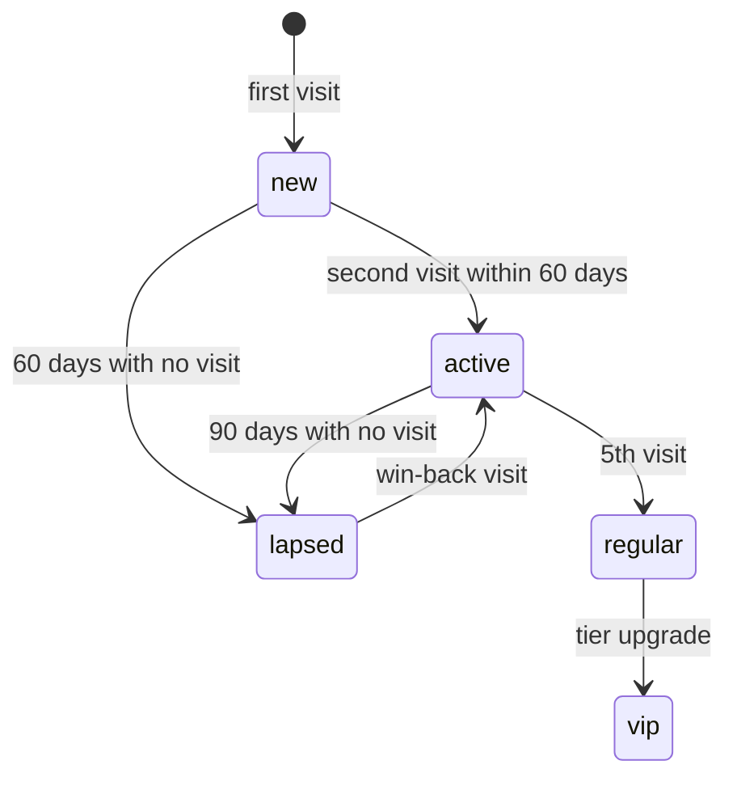

# CRM: *the owned relationship*

The module behind the Retention engine: the guestbook, the segments, the always-on automations, the campaigns and the loyalty program, over Resend for email and Toast for the guest and the visit.

## Responsibilities

| Area | What it includes |
| --- | --- |
| Capture | Opt-ins from the POS, the WiFi captive portal, the QR survey, online-order and reservation checkouts; each contact keeps its origin |
| Guestbook | One profile per guest with visits, lifetime value, tag and last visit, from the Toast CRM |
| Segments | Regulars, lapsed, VIP, new, birthdays, by opt-in source |
| Automations | 24 h welcome, birthday, 60-day win-back, 90-day lapsed |
| Campaigns | Email (2–4 a month), segmented, with a revenue window of 14 days |
| Loyalty | The anonymous stamp card, built (see below); visit-based tiers and VIP recognition come later |
| Cohorts | Retention by month since first visit |

## What is built

Only the loyalty core exists today (`modules/crm`, Postgres schema `crm`); the guestbook, segments, automations, campaigns and cohorts are delivery C. The guide [Loyalty and the stamp card](../guides/loyalty-and-qr-card) says how a venue uses it and [ADR 0022](../adr/0022-loyalty-card-device-bound) records the decisions.

| Piece | State |
| --- | --- |
| Programs, cards, stamps, rewards, redeem and void | Built, with row-level security, an advisory lock, idempotency and audit |
| Email opt-in with consent (source `loyalty_card`) | Built, unverified; double opt-in is delivery C |
| Activity list and band figures | Built |
| Public and staff API routes | Built (`/v1/loyalty/*`, `/api/loyalty/*`, `/api/insights/loyalty`) |
| Erasure: a card is detached from an erased guest | Built, a consumer in the worker |
| The card page and the Platform and Manager screens | Delivery B |
| Wallet passes | Delivery D |

## The loyalty model

- **One program per location**: stamps needed (2 to 20), reward text, cooldown (0 to 1440 minutes), an accent colour, active or paused.
- **A card is anonymous and belongs to a device.** It has a hashed token and an 8-character short code. A guest is linked only by the optional email opt-in; several cards may share one guest.
- **Progress is derived** from the append-only events `stamp`, `reward_earned`, `reward_redeemed` and `void`; nothing stores a running count.
- **Core support:** Core exports `userDisplayNames`, carries the `loyalty` permission matrix (`read`, `stamp`, `redeem`, `manage`) and accepts the consent source `loyalty_card`.

## Rules in code

- `canContact` is checked on every send.
- Every message carries an opt-out; an opt-out is a signal and updates the consent log at once.

## Guest lifecycle

## MCP tools

| Tool | Writes | Initial level |
| --- | --- | --- |
| `crm.get_guest` | No | 4 |
| `crm.list_segment` | No | 4 |
| `crm.fire_automation` | Yes | 4 |
| `crm.draft_campaign` | Yes (draft) | 2 |
| `crm.send_campaign` | Yes | 3 |
| `crm.recognize_milestone` | Yes | 4 |
| `crm.get_loyalty_card` | No | 4 |

`crm.get_loyalty_card` is built in the module but is not registered in the agents service until delivery C, when the CRM agent gets its manifest.

## Events

**Publishes:** `loyalty.card.issued`, `loyalty.stamp.added`, `loyalty.reward.earned`, `loyalty.reward.redeemed` and `contact.captured` (built); `automation.fired`, `campaign.sent` (delivery C). `loyalty.reward.earned` is the canonical name and replaces the earlier `loyalty.milestone.reached`.
**Consumes:** `guest.erased` (built); `consent.changed`, `survey.response.submitted` (delivery C).

## Metrics

Repeat guest rate, loyalty members, open rate and click rate (later, with marketing and CRM), redemptions, win-back returns, email revenue and opt-outs: the Retention rows of the [metric inventory](../data/metrics-and-scoring).
