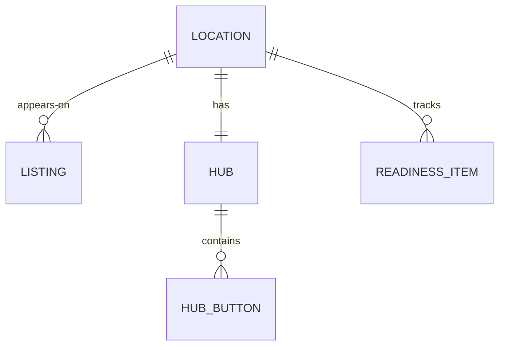

# Discoverability: *set up to be found*

The module that keeps the digital front door correct. It holds the checklist whose points make up the setup-readiness score, the state of every listing, the landing hub configuration and the health of the site's tags.

## Responsibilities

| Area | What it includes |
| --- | --- |
| Setup readiness | Items per category (GBP, listings, SEO, profiles, links, pixels), each worth points based on the services that run; the sum is the 0–100 readiness |
| Listings | Google Business Profile, Apple Maps, Yelp, Facebook, TripAdvisor, Bing Places and delivery apps: status (synced, fix hours, missing) and the last check |
| Landing hub | The restaurant's link page: buttons (order, reserve, directions, call, menu, website), their order and stage, UTM handling and the public page |
| Site health | Schema present, menu link live, pixel firing, bio-link health |

## Entities

## MCP tools

| Tool | Writes | Initial level |
| --- | --- | --- |
| `discoverability.list_listings` | No | 4 |
| `discoverability.get_readiness` | No | 4 |
| `discoverability.propose_listing_fix` | Yes (a proposal) | 2 |
| `discoverability.update_gbp` | Yes | 3 |
| `discoverability.update_hub_button` | Yes | 3 |

## Events

**Publishes:** `listing.drift.detected`, `hub.button.updated`.
**Consumes:** `package.changed`.

The hub's button taps are signals, written to `signals_daily` with the source `landing`.
