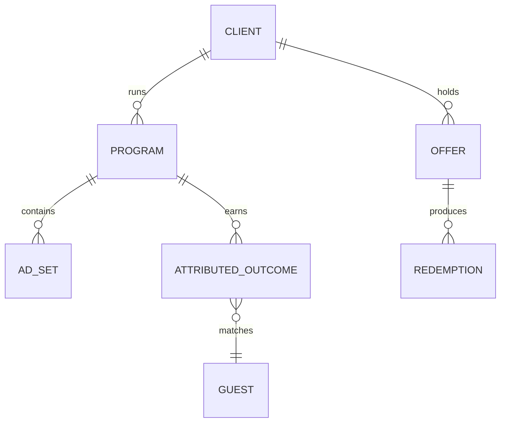

# Growth: *every dollar, traced to an order*

The module behind the Growth engine. It plans and tracks paid programs, holds the offers the restaurant puts behind the marketing, and attributes every order and reservation to its source with its method.

## Responsibilities

| Area | What it includes |
| --- | --- |
| Always-on programs | The three buckets where every standing ad dollar lands: on-premise (estimated), online orders and reservations, each with goal, result, budget and pacing |
| Custom campaigns | Events, catering and one-offs with their own goal and budget |
| Offers | The deal, its terms, its status and every redemption, turned into ads, reels, email, SMS and in-store |
| Attribution | Identity stitching, the attribution methods, channel → stage → outcome and source → journey → outcome |
| Pacing | Spend against budget with a projection to the end of the period |

## Entities

## Rules in code

- An estimate is a field, not a footnote: `on-premise sales` is stored with `method = estimate`.
- A launch, a budget move or a price or menu claim creates an approval request.
- The ROAS shown for a program is `sales ÷ spend` over the same range, with sales split into verified and estimated.

## MCP tools

| Tool | Writes | Initial level |
| --- | --- | --- |
| `growth.get_pacing` | No | 4 |
| `growth.attribute_order` | Yes (with its method) | 4 |
| `growth.propose_campaign` | Yes (a proposal) | 2 |
| `growth.brief_creative` | Yes (a brief) | 2 |
| `growth.shift_budget` | Yes | 3 (stays at 3) |

## Events

**Publishes:** `campaign.launched`, `budget.pacing.alert`, `offer.redeemed`, `order.attributed`.
**Consumes:** `guest.identified`, `campaign.sent`, `content.published`.

## Metrics

Spend, paid impressions, clicks, orders and reservations from ads, matched on-premise orders, on-premise sales (estimated), ROAS, cost per action and leads: the Growth rows of the [metric inventory](../data/metrics-and-scoring).
