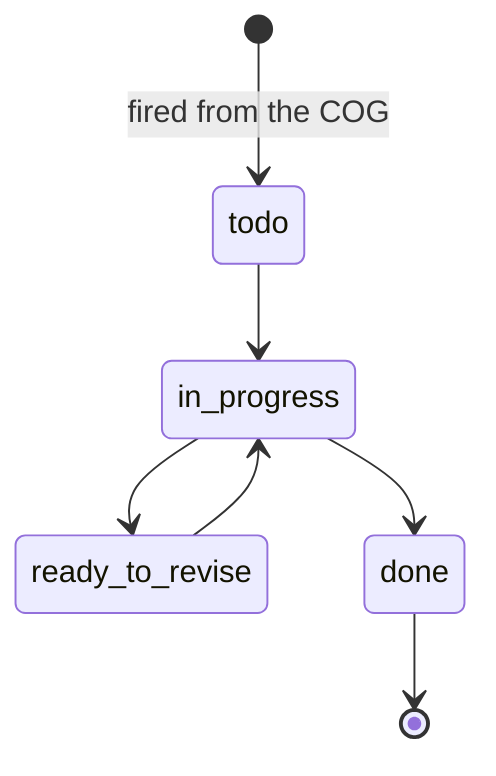

# Ops: *the promise, priced in units*

The module that turns a client's promise into work. The COG lists measurable, deliverable units; the cycle calendar fires the tasks; the daily entry logs what shipped.

## Responsibilities

| Area | What it includes |
| --- | --- |
| COG | Account team, scope by group, cycle calendar, work volume, label ceilings, standing guardrails, standing weekly rules, tech stack status, key dates and the change log |
| Cycles | The monthly cycle anchored to the billing date; the stage that is current |
| Tasks | Stage nature, task type, status, responsible, standard and actual hours, due status; fired from the COG by the Account Manager |
| Daily entry | A timestamped manual log per client, with the sections the package unlocks; writes `signals_daily` with `source = manual` |
| Capacity | Standard hours by role against the people assigned |

## States

## MCP tools

None. Ops is operated by people; agents read the COG through `ops.get_cog` (level 4) so that their guardrails match the client's.

## Events

**Publishes:** `task.fired`, `task.completed`, `cycle.started`.
**Consumes:** `content.status.changed`.
