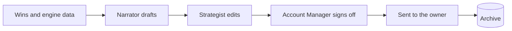

# Reports: *the story of the month*

The module that turns a month of data into the document the client reads. It builds the report from the wins and from every engine's data, writes the narrative, and keeps the archive.

## Responsibilities

| Area | What it includes |
| --- | --- |
| Report builder | Choose which engines to include (for example Retention off for an Essential client), the range and the format; build and download, or schedule monthly |
| Wins | Wins collected all month by the agents (best post, a story that drove directions, a regulars email), the moments worth putting in the report |
| Narrative | A short story generated from the month's data, edited by the strategist before it is sent |
| Archive | Every report sent, with its date and recipient |
| Roadmap | The 90-day plan tied to goals and seasonality |

## Flow

## MCP tools

| Tool | Writes | Initial level |
| --- | --- | --- |
| `reports.get_wins` | No | 4 |
| `reports.draft_report` | Yes (a draft) | 3 (a person approves before it is sent) |
| `reports.draft_roadmap` | Yes (a draft) | 2 |

## Events

**Publishes:** `report.generated`, `report.sent`.
**Consumes:** `score.computed`, `order.attributed`, `content.published`.
