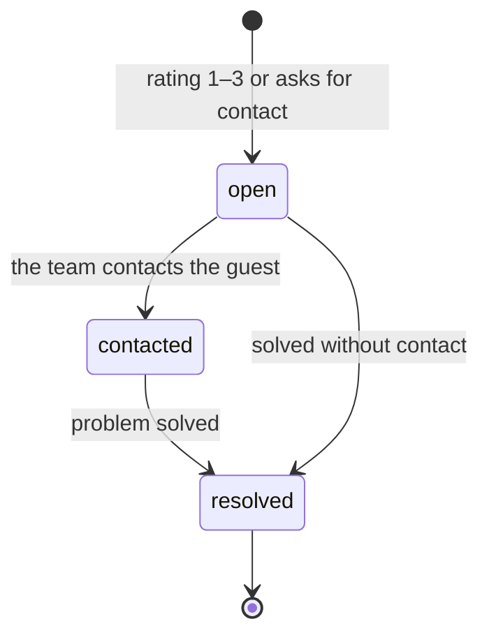

# Reputation: reviews, replies and a *survey of under a minute*

The module behind the Reputation engine. It stores reviews and replies, runs the survey flow that catches problems early, and opens recovery cases. It works on its own with a QR on the table.

## Responsibilities

| Area | What it includes |
| --- | --- |
| Reviews | Reviews from Google, Yelp and others, with rating, text, reply status and delay; themes |
| Replies | Draft, approve and publish in the brand voice; negatives need the Account Manager's written sign-off |
| Survey flow | The post-visit survey, QR per location and signed single-use links |
| Review requests | Sent to every guest after a visit, timed to the happy moment |
| Recovery cases | Open, contacted, resolved, with the first-response target of 24 h |

## How the survey arrives

| Entry | Detail |
| --- | --- |
| QR per location | On table tents and receipts; anonymous, with a per-device submission limit |
| Post-order | After an order the guest can scan or tap; the order links the response to the guest when it is known |
| Manual send | To a guest with consent, from the Manager |
| CSV import | A list of guests with recorded consent |

Each invitation is a signed single-use link that expires in 7 days.

## Questions (template v1)

1. How was your visit? — 1 to 5
2. What was the best part? — quick options
3. What can we improve? — quick options
4. Free comment, optional
5. Would you like the manager to contact you? — optional, and only then it asks for a phone or email

The template is versioned: changing questions does not break earlier responses. An anonymous response never opens a case that needs contact details unless the guest leaves them.

## Final screen

:::danger System rule
Everyone sees the button to leave a Google review, regardless of their rating. The link is added by the system and never depends on the response. The private channel is offered in addition, never instead. See [ADR 0018](../adr/0018-no-review-gating).
:::

Everyone also sees the option to talk to the manager. The review click is recorded as a signal.

## Recovery cases

Immediate email alert to the owner and the Account Manager. A public review is never linked to a guest by guessing: a case opens from a survey response, or when the Account Manager links the review.

## MCP tools

| Tool | Writes | Initial level |
| --- | --- | --- |
| `reputation.list_reviews` | No | 4 |
| `reputation.list_responses` | No | 4 |
| `reputation.classify_response` | Yes (labels) | 4 |
| `reputation.open_case` | Yes | 4 |
| `reputation.draft_reply` | Yes (draft) | 2 |
| `reputation.publish_reply` | Yes | 3 (negatives stay at 3) |
| `reputation.send_review_request` | Yes | 4 |

## Events

**Publishes:** `review.received`, `review.replied`, `survey.sent`, `survey.response.submitted`, `recovery.case.opened`, `recovery.case.resolved`, `review.link.clicked`.
**Consumes (optional):** `contact.captured`.

## Metrics

Response rate, reply time, rating, review velocity, 5-star share, review-request conversion and survey score: the Reputation rows of the [metric inventory](../data/metrics-and-scoring).
