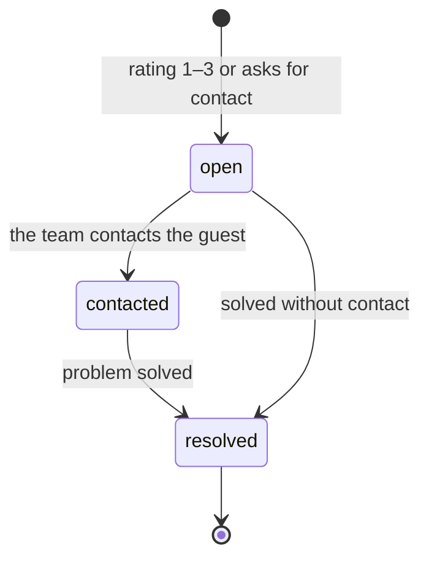

# Reputation: reviews, replies and a *survey of under a minute*

The module behind the Reputation engine. It stores reviews and replies, runs the survey flow that catches problems early, and opens recovery cases. It works on its own with a QR on the table.

## Responsibilities

| Area | What it includes |
| --- | --- |
| Reviews | Reviews from Google, Yelp and others, with rating, text, reply status and delay; themes |
| Replies | Draft, approve and publish in the brand voice; negatives need the Account Manager's written sign-off |
| Survey flow | The post-visit survey, QR per location and signed single-use links |
| Review requests | Sent to every guest after a visit, timed to the happy moment |
| Recovery cases | Open, contacted, resolved, with the first-response target of 24 h |

## How the survey arrives

| Entry | Detail |
| --- | --- |
| QR per location | On table tents and receipts; anonymous, with a per-device submission limit |
| Post-order | After an order the guest can scan or tap; the order links the response to the guest when it is known |
| Manual send | To a guest with consent, from the Manager |
| CSV import | A list of guests with recorded consent |

Each invitation is a signed single-use link that expires in 7 days.

## Questions (template v1)

1. How was your visit? — 1 to 5
2. What was the best part? — quick options
3. What can we improve? — quick options
4. Free comment, optional
5. Would you like the manager to contact you? — optional, and only then it asks for a phone or email

The template is versioned: changing questions does not break earlier responses. An anonymous response never opens a case that needs contact details unless the guest leaves them.

## Final screen

:::danger System rule
Everyone sees the button to leave a Google review, regardless of their rating. The link is added by the system and never depends on the response. The private channel is offered in addition, never instead. See [ADR 0018](../adr/0018-no-review-gating).
:::

Everyone also sees the option to talk to the manager. The review click is recorded as a signal.

## Recovery cases

Immediate email alert to the owner and the Account Manager. A public review is never linked to a guest by guessing: a case opens from a survey response, or when the Account Manager links the review.

## Reading guests' words

When a response is submitted, the Sentiment subagent reads the comment and the two chosen options through a language model ([0019](../adr/0019-llm-provider-behind-a-port)) and stores internal labels on the response: sentiment, topics, a concern level (low, medium or high) and a safety flag. The tool is `reputation.read_response`, and the reading ends with the event `survey.response.read`. Only labels travel in events, never the guest's text.

Recovery listens to both events. It decides alone: a reading opens a case when concern is medium or high, or when safety is true. Severity only escalates: a case takes the higher of the rating's severity and the reading's, and if one already exists for the response it is raised, never lowered. Sentiment cannot open a case, notify anyone or touch the review link.

None of this changes who is asked for a review. The Google button never depends on the rating or on the reading ([0018](../adr/0018-no-review-gating)). If the model fails or is unavailable, the response stays unread and Recovery keeps working from the rating. Grouping themes across responses daily is later work, with the dashboard.

Sentiment's daily cap (500 readings) also counts responses with no comment. A response refused at the cap stays unread; re-reading old responses is out of scope.

## Help requests as conversations

A help request is a thread between a client and the agency, not a one-shot note. The client opens it in the Platform (Help page) with a first message, which is required, and answers there. The agency answers in the same thread in the Manager (Help requests). Each message carries its author, the author's side (client or agency) and a time. Legacy requests with no note show the placeholder `(no message)`.

| Role | Reads | Writes | Closes |
| --- | --- | --- | --- |
| `client_owner` | Yes | Yes | Only as Solved |
| `agency_admin` | Yes | Yes | Solved or Declined |
| `account_manager` | Yes | Yes | Solved or Declined |
| `agency_staff` | Yes | No | No |
| `client_staff` | No access | No | No |

A message posted in a closed case reopens it, so a reply after Solved puts the thread back to Waiting. A request closed twice answers `409 invalid_state`.

A message can carry one attachment, of two kinds:

- **A survey response**, shown as a card with the rating, the comment, the agent's labels, the date and the location. The card never shows contact details. In the Platform, Responses has "Ask for help about this", which opens Help with the response and its place already chosen. The response must belong to the request's client and to a place the author can see; otherwise it is refused with `422 attachment_not_found`. The attach picker lists only the recent responses of that client.
- **An external review**, as an `https` link plus optional text and stars.

Every message or close notifies everyone who handles the client except its author (the owners and the assigned team) with the kind `reputation.help_message`. The notification carries a preview of at most 140 characters and links to the Help page, not to the specific thread. The list and the open thread refresh every 15 seconds while the tab is visible.

The API replaced `POST /surveys/requests/:id/handle` with `GET /surveys/requests/:id`, `POST /surveys/requests/:id/messages`, `POST /surveys/requests/:id/close` and `GET /surveys/responses/pickable`.

Out of scope: file attachments, real time, unread counters, editing or deleting messages, and agents taking part in threads.

## MCP tools

| Tool | Writes | Initial level |
| --- | --- | --- |
| `reputation.list_reviews` | No | 4 |
| `reputation.list_responses` | No | 4 |
| `reputation.classify_response` | Yes (labels) | 4 |
| `reputation.read_response` | Yes (labels) | 4 |
| `reputation.open_case` | Yes | 4 |
| `reputation.draft_reply` | Yes (draft) | 2 |
| `reputation.publish_reply` | Yes | 3 (negatives stay at 3) |
| `reputation.send_review_request` | Yes | 4 |

## Events

**Publishes:** `review.received`, `review.replied`, `survey.sent`, `survey.response.submitted`, `survey.response.read`, `recovery.case.opened`, `recovery.case.resolved`, `review.link.clicked`.
**Consumes (optional):** `contact.captured`.

## Metrics

Response rate, reply time, rating, review velocity, 5-star share, review-request conversion and survey score: the Reputation rows of the [metric inventory](../data/metrics-and-scoring).
