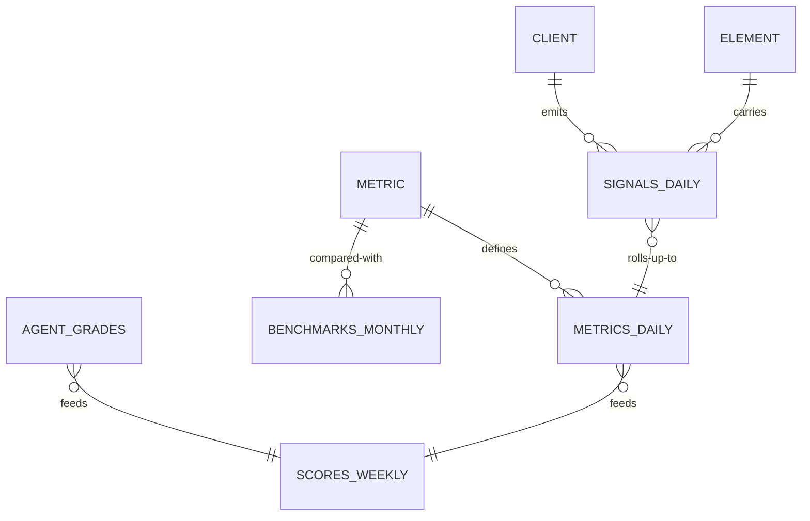

# Signals: *the data backbone*

The `signals` module owns the six tables of the [data model](../data/storage-and-pipeline) and the read API every surface uses. It is the first module built after Core, because every other module and every agent reads from it.

## Responsibilities

| Area | What it includes |
| --- | --- |
| Ingestion | A validated, idempotent API for connectors, first-party sources and manual entries; unknown `signal_type` values are rejected |
| Signals | `signals_daily`, partitioned by month; stitching by `guest_id` |
| Metrics | The metric registry (the inventory) and the rollup job that rebuilds `metrics_daily` idempotently |
| Benchmarks | `benchmarks_monthly` with a sample size per metric; aggregates only |
| Grades | `agent_grades` written by observing subagents, with the Account Manager's override and note |
| Scores | `scores_weekly`: measured, practice, score, the radius score, and the Growth Score row |
| Read API | Range math over daily rows: sum, trend, rate, latest, compare, score, per location |

## Entities



## Ingestion contract

```ts title="packages/contracts/src/signals.ts"
export const SignalRowV1 = z.object({
  date: z.string().date(),
  locationId: z.string().uuid(),
  source: z.enum(['metricool', 'gbp', 'landing', 'site', 'toast', 'twilio',
    'meta_ads', 'google_ads', 'survey', 'review', 'manual', 'agent']),
  platform: z.enum(['instagram', 'facebook', 'tiktok', 'youtube', 'google', 'meta']).optional(),
  elementId: z.string().optional(),
  signalType: SignalType,            // the canonical enum
  value: z.number(),
  meta: z.record(z.unknown()).optional(),
  guestId: z.string().optional(),
});
```

## MCP tools

| Tool | Writes | Initial level |
| --- | --- | --- |
| `signals.get_scores` | No | 4 |
| `signals.get_metric` | No | 4 |
| `signals.list_alerts` | No | 4 |
| `signals.write_grade` | Yes (a practice grade with evidence) | 4 |

## Events

**Publishes:** `signals.ingested`, `metrics.rebuilt`, `score.computed`, `benchmark.updated`, `grade.written`.
**Consumes:** `package.changed`.

## Metrics

Freshness per source, rows ingested and rejected, rollup duration, and the share of metrics with a benchmark.
