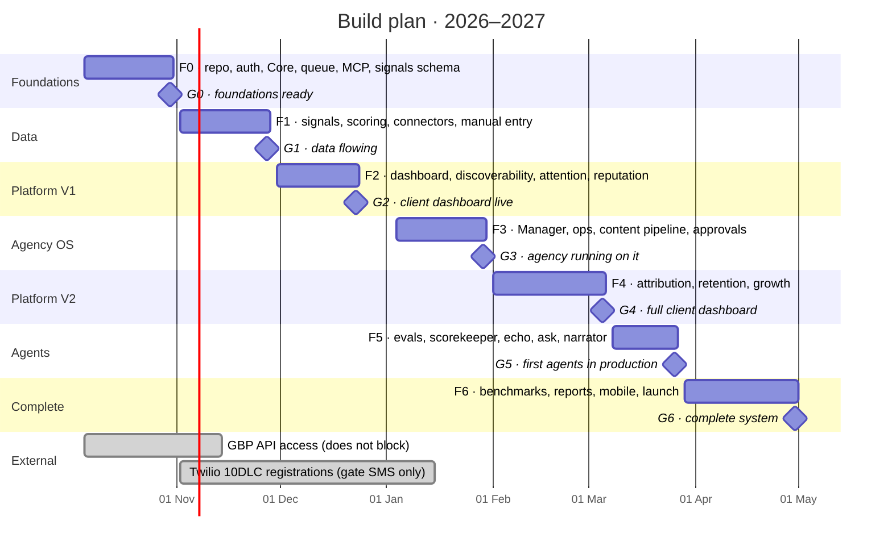

# Foundations in four weeks, *data in eight*, a client dashboard by Christmas

Calendar with one developer working with Claude Code, starting Monday 5 October 2026. The plan is ordered by what everything else depends on: first the data, because every screen, every score and every agent reads it; then the client's dashboard, then the agency's tools, then the layers that need both. With two developers, phases F2 and F3 and phases F5 and F6 run in parallel and the total drops to about 20 weeks.

| Phase | Dates | What is delivered |
| --- | --- | --- |
| **F0 · Foundations** | 5–30 Oct | Repo with Bun, CI/CD, environments, auth with organizations and team roles, Core (guests, consents, packages, event queue, approvals, audit), MCP gateway and policy engine, base UI, the signals schema and the ingestion API |
| **F1 · Data backbone** | 2–27 Nov | Metric registry, rollups, scoring package, benchmarks, agent grades, manual daily entry, N8N with Toast, Metricool, Google Business Profile, Meta Ads and Google Ads |
| **F2 · Platform V1** | 30 Nov–23 Dec | The Platform shell, Dashboard, Discoverability, Attention and Reputation, the hub, the survey flow and the review feed; 2 clients in pilot with real data |
| **F3 · Agency OS** | 4–29 Jan | The Manager: portfolio, client workspace, COG, tasks fired from it, content pipeline, studio, approvals, daily entry and data status; the Platform's Management section |
| **F4 · Platform V2** | 1 Feb–5 Mar | Attribution with identity stitching, Retention with Twilio (SMS once registered), Growth programs and offers, package access enforced |
| **F5 · Agents** | 8–26 Mar | Evals harness, practice grading, Scorekeeper, Echo, Ask, Sentiment, Narrator and Strategist in production |
| **F6 · Complete** | 29 Mar–30 Apr | Benchmarks, Reporting and Settings, the report builder, the owner app on Mobile, calibration of weights, portfolio migration |

The foundations take four weeks because they include the MCP gateway, the policy engine and the signals schema. The holiday week (28 December to 1 January) is not scheduled. The dates are estimates for one developer and are validated in week 0; see [Open decisions](./open-decisions). See [Gates](./gates) for the exit criteria of each phase.

:::caution Weeks that carry risk
F2 ends on 23 December and F1 contains Thanksgiving; the plan has no buffer. If the pilot clients are not chosen and their sources connected by the end of F1, G2 moves.
:::
