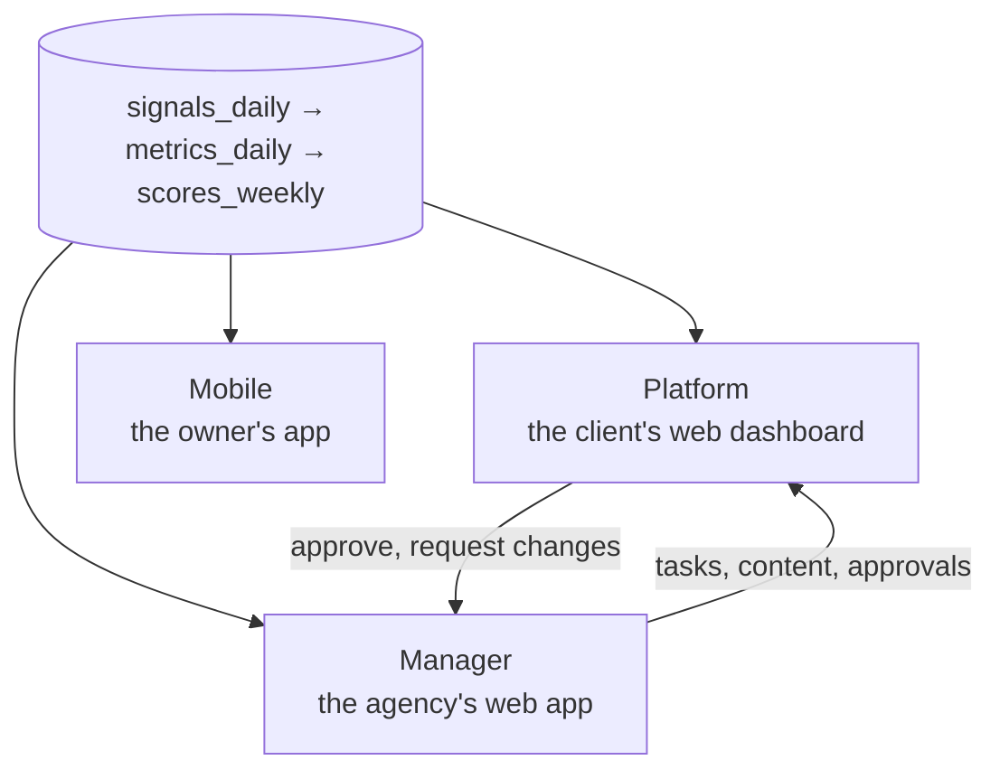

# Three surfaces, *one data model*

Everyone reads the same numbers from the same tables. What changes is who is looking and what they can do.

| Surface | Audience | What it is | Built in |
| --- | --- | --- | --- |
| [Platform](./platform) | Restaurant owner and staff | The Growth OS: five engines, the Growth Score, attribution, content approvals, benchmarks and reports | Next.js |
| [Mobile](./mobile) | Restaurant owner | The owner app: live feed, five engines, reach, reviews, guests and the team, in the pocket | Expo (React Native) |
| [Manager](./manager) | Atrium team | The Agency OS: portfolio health, client workspaces, delivery projects, tasks, content pipeline, COG, approvals, data status | Next.js |

[Packages and access](./packages-and-access) controls which Platform and Mobile sections are live for each client.

:::tip What is built today
The pages for each surface describe the full product. For what runs now, who signs in where and the guest-feedback flow from an order to a resolved case, read [Using the system today](./using-the-system).
:::

## Shared rules

- **Counts before dollars.** Attribution leads with guests earned; dollars are the by-product, and each carries its method.
- **Every number is judged three ways:** against the prior period, against the 10-mile radius (the amber tick) and across any date range.
- **Every number resolves to a metric** in the [inventory](../data/metrics-and-scoring). A number that cannot be traced to a row does not ship.
- **Locked pages stay visible,** so a client can see what the next package unlocks.
- **Everything that speaks for the client or spends their money** goes through an approval, in the same queue on every surface.
