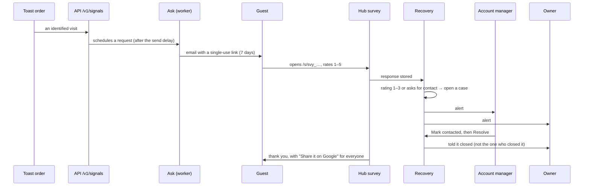

# Using the system *today*

The [Platform](./platform) and [Manager](./manager) pages describe the full product. This page describes what is **built and running** now, as it was walked through in a live environment. Everything here is the Reputation engine and the shell around it; the rest of the sections appear in the navigation, locked or as a teaser.

:::note How this was validated
The flow was driven end to end against a local build (API, worker, Platform, Manager and Hub on seeded demo data), with a scripted browser and a read of the database after each step. Nothing on this page comes from a mock. See [Local development](../guides/local-development) to repeat it.
:::

## Who signs in where

| Surface | Port locally | Who | What they do |
| --- | --- | --- | --- |
| **Hub** | 3004 | The guest, no account | Opens a survey link or a QR, answers, and optionally asks for contact. Also the public "request access" form |
| **Platform** | 3003 | The client: owner and staff | Sees the guest feedback of their own places, shares the QR, asks the Atrium team for help |
| **Manager** | 3002 | The agency: account manager and team | Works the recovery cases, configures forms and QR per place, approves accounts and places, answers help requests |
| **API** | 3001 | The three surfaces and the connectors | One API for all; every screen is a client of it |

Sign-in is by email and password on Platform and Manager. A client gets in through [onboarding](#onboarding-a-client): the owner asks for access on the Hub, the agency approves, and the owner sets a password.

## The main flow: from an order to a resolved case

What each step does, as observed:

1. **An order arrives** through the ingestion API, with the guest identified. Ask schedules a review request for that guest, delayed by the place's *Send delay* (0 minutes by default). The worker sends it in the next minute.
2. **The guest gets an email**, sent through Resend, with the place name, a button to a link `…/s/svy_…` and an unsubscribe link in the footer. The link works **once** and expires in 7 days; opening it again answers `410`.
3. **The survey** shows a 1–5 emoji scale. From 4 up it asks *What was best?*; at 3 or below it asks *What should we improve?* (Food, Service, Atmosphere, Value, Speed, Cleanliness, Nothing). A free comment is optional. A switch, *I would like someone to contact me*, reveals name, email and phone: the form will not send until there is an email or a phone.
4. **The thank-you screen** always offers **Share it on Google**, whatever the rating. This is a rule, not a setting: [ADR 0018](../adr/0018-no-review-gating).
5. **Recovery opens a case** when the rating is 1–3 or the guest asks for contact. A 2 with contact opened a `medium` case due in 1 day. Severity only goes up if a reading says so ([Reading guests' words](../modules/reputation#reading-guests-words)).
6. **The team is alerted**: one notification per recipient, the owner on the Platform and the account manager on the Manager, in the notifications bell and by email (kind `reputation.case_alert`). A case that is later raised to a higher severity alerts again.
7. **The account manager works the case**: opens it, reads the comment and the contact, uses **Mark contacted** and then **Resolve**, with an optional note for the record. **Mark contacted** tells no one. **Resolve** emits `recovery.case.resolved` and notifies the owners and the assigned team, except the person who resolved it (kind `reputation.case_resolved`). So people hear about a case twice: when it opens or is raised, and when it closes.
8. **Everything is audited**: Ask's send, Recovery's classification and the case opening each leave a row in the audit log with the agent that acted.

## What each role sees

### Guest (Hub)

The survey, the thank-you screen and the *Request access* form for a new business. The Hub's home page is an empty state ("Nothing here") that points to that form. No account, no navigation.

### Client owner (Platform)

| Area | What it holds |
| --- | --- |
| **Overview** | Rating, responses, review link clicks and open cases with their change, topics, places. See [Reading the Overview](../guides/reading-the-overview) |
| **Reputation → Feedback** | The recovery cases of the client's places, filtered by status, with severity and how long each has waited |
| **Reputation → Responses** | What guests answered, with a filter for 3 stars or fewer and a button to ask the Atrium team about a response |
| **Reputation → QR & links** | Each place's printed QR (copy, preview), the Google review link (read only: *only the Atrium team can change this*), the send delay and a **Generate link** for a one-time link |
| **My places** | The places and their state; a new place is asked for here and approved by the agency |
| **Help** | A conversation with the Atrium team: choose a place, say what is needed, follow the thread. See [Help requests as conversations](../modules/reputation#help-requests-as-conversations) |
| **Notifications** | What needs the owner and what was decided, with mark all as read |
| **Modules** | Content, Analytics, Discoverability, Attribution, Growth and Management open as teasers. **Retention** and **Benchmarks** show a lock, from the client's [package](./packages-and-access) |

### Account manager (Manager)

| Area | What it holds |
| --- | --- |
| **Overview** | The whole portfolio: a queue of what needs a person, time to contact, overdue cases, portfolio rating, clients. See [Reading the Overview](../guides/reading-the-overview) |
| **Reputation → Cases** | Every client's cases, with a detail panel: rating, what to improve, what the guest wrote, how to reach them, a note, and the status buttons |
| **Reputation → Responses** | All responses with badges: *Link*, *QR*, *Wants contact*, *Recovery case* |
| **Reputation → Forms & QR** | Per place: QR (copy, preview, **Rotate QR**), the Google review link, the send delay, one-time links. Only the agency can edit the review link |
| **Reputation → Help requests** | The clients' threads, answered in the same conversation |
| **Approvals** | Accounts and places waiting for the agency's OK |
| **Clients → Places** | Every place across clients, waiting or running, with **Pause** |
| **Notifications** | The same bell, with the agency's alerts |

## Onboarding a client

1. The owner fills **Request access** on the Hub (business, owner, email, first place, time zone, a note). The form always answers `202`, so nobody can learn which emails exist, and it is rate limited.
2. The request appears in the Manager under **Approvals → Accounts**. The agency approves or rejects it.
3. On approval the system creates the client and its organization, makes the owner a `client_owner`, assigns the client to the approver when that is an account manager, and issues a **set-password link**. The owner also receives that link by email (this email is not recorded in the outbox) and the approver still sees it. The owner sets a password on the Platform and signs in.
4. A new place is requested from **My places** and approved under **Approvals → Places** before Ask can use it.

## What is not built yet

The navigation shows the whole product on purpose, so a client sees what the next package unlocks. Today only these are live:

| Live | Visible but not built |
| --- | --- |
| Guest survey, QR and one-time links | Growth Score, the map, scores and metrics screens |
| Ask: review requests from an order | Discoverability, Attention, Retention, Growth, Attribution and Benchmarks content |
| Recovery cases and their alerts | Projects, tasks, content pipeline, COG and daily entry in the Manager |
| Help requests as conversations | The mobile app |
| Notifications, approvals and places | Reports |
| Sentiment reading, **only when a model is configured** | |

Without a model, Sentiment's task answers `rejected` ("no model is configured") and nothing retries it. Cases still open from the rating alone, as the [Reputation](../modules/reputation) page says.
