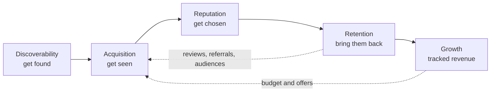

# The Growth System, on *one page*

The Growth System is how Atrium grows a restaurant: **five engines**, each owning one question, all measured by the same chain of data (signal → metric → score) and combined into one number, the **Growth Score**. This documentation is the single source of truth for the agency and for the platform that runs it.

:::info Documentation rule
If a name, a metric or a threshold is not here, it is not used in code, reports or sales. If a new one is needed, it is added here first.
:::

## Three problems, five engines

| Problem | What the owner says | Engines | Journey stages |
| --- | --- | --- | --- |
| Invisibility | "They don't know we exist" | [Discoverability](./engines#discoverability) · [Acquisition](./engines#acquisition) | Stranger → Discovery |
| Trust | "They find us but don't choose us" | [Reputation](./engines#reputation) | Consideration → First Visit |
| Retention | "They came once and never came back" | [Retention](./engines#retention) · [Growth](./engines#growth) | First Visit → Loyal Regular |

## One number

Every engine gets a score from 0 to 100: 60% measured against the restaurant's own 10-mile radius, 40% judged against a practice rubric. The five scores add up to the **Growth Score, 0–300**. See [Metrics and Growth Score](./metrics).

## How to read this documentation

- **[System](./glossary)**: the business model. Glossary, engines, customer journey, services and packages, metrics, risks.
- **[Agents](../agents)**: each engine turned into an agent with subagents, autonomy and rules.
- **[Data](../data)**: how every number is produced: signals, sources, metrics, scores, storage.
- **[Product](../product)**: the three surfaces people use: Platform, Manager and Mobile.
- **[Architecture](../architecture)**: how the platform is built and why.
- **[Modules](../modules)**: the specification of each module.
- **[Plan](../plan)**: phases, gates, tests and open decisions.
- **[Decisions](../adr)**: every important technical decision, with its context.
- **[Guides](../guides)**: how to work in the repository.
