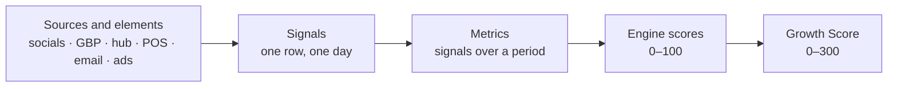

# Metrics and the *Growth Score*

Everything a screen shows is math over one atomic thing: a daily-stamped **signal**. Metrics are built from signals, each engine blends measured and practice into a score, and the five scores become the **Growth Score**. The full metric inventory lives in [Metrics and scoring](../data/metrics-and-scoring); this page is the model.

## From signal to score



## The score

```text
engine score  = 0.6 × measured + 0.4 × practice
measured      = average over the engine's metrics of  min(you ÷ benchmark, 2) ÷ 2 × 100
practice      = criteria graded 0–4 by agents on a fixed rubric, normalized to 0–100
Growth Score  = 0.6 × (Discoverability + Acquisition + Reputation + Retention + Growth)   → 0–300
```

- **Benchmark** is the average of restaurants within a 10-mile radius, per metric, monthly. A metric without a benchmark still renders, just without the amber tick, and is left out of the measured half.
- **Practice** criteria are things no API reports (posting consistency, reply quality, list hygiene). They are graded weekly and written to `agent_grades`; the Account Manager can override a grade with a note.
- **Weights** are editable per engine; the defaults above are the starting proposal and are calibrated with the first 5 clients.
- The Growth Score is shown next to the same blend for the 10-mile radius, so every number is judged three ways: against the prior period, against the radius, and over any date range.

## Colors

Each engine score uses one rule everywhere: **80+ green, 60–79 amber, below 60 red**. The Growth Score uses the same thresholds scaled to 300 (240 and 180).

## Metric rules

1. One name per metric. The canonical label is on the left of the [vocabulary](../data/metrics-and-scoring#one-name-per-metric); synonyms never ship.
2. Each metric has a fixed unit, a formula over signals, a funnel stage and an engine.
3. A metric that is estimated says so. On-premise sales are matched orders × average ticket; they are never presented as verified.
4. Temporal correlation is never summed as attributed revenue. Every attributed dollar shows its method (pixel, code, loyalty phone or email, card match, manual).

## Economics: hypotheses to validate

```text
LTV = average check × visits per year × years of relationship = 28 × 6 × 5 = 840
```

| Assumption | Value | How it is validated |
| --- | --- | --- |
| Average check | $28 | Toast sales summary or the owner, per client |
| Visits per year | 6 | Repeat visits of identified guests over 12 months |
| Years of relationship | 5 | Retention curves per cohort |
| Cost of a new guest via paid | $5–20 | Ad spend / new attributed guests |
| Cost of reactivating a guest | $1–5 | Send costs / reactivated guests |
| Show rate (manual estimate) | 0.30 of intent actions become a visit | Kept unless the Account Manager sets another per client |

These figures are only used in sales with real data from at least one client, or presented as an estimate.

### Principles behind the numbers

- **The shortlist principle.** Guests choose from a mental shortlist of 3–5. The whole system exists to enter it before hunger strikes.
- **Mere exposure.** 1–2 views: awareness. 3–10: familiarity. 10+: preference, recalled unprompted. A consistent calendar beats any single viral post.
- **Review credibility.** Rating × volume × recency. A 4.5★ with 2,500 reviews beats a 4.8★ with 40.
- **Retention vs acquisition.** New guest via paid: $5–20. Lapsed guest re-engaged: $1–5. Active guest via email: cents.
- **Owned vs rented reach.** 5,000 owned contacts beat 50,000 followers; platforms are rented, a database is owned.
