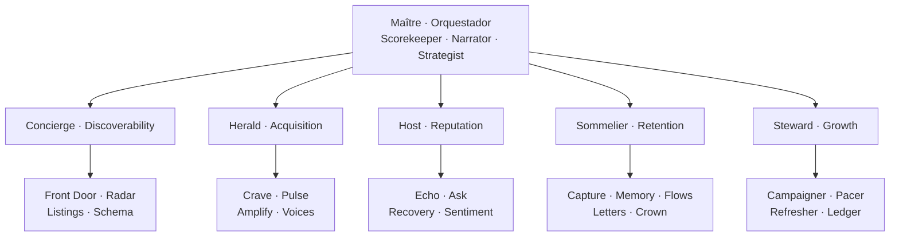
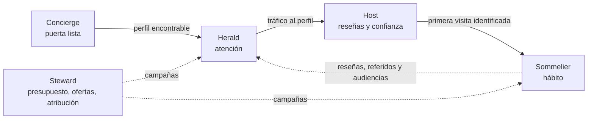

# Un orquestador, *cinco engines con nombre*

Cada engine del Growth System se convierte en un agente con nombre, carácter y reglas propias. Maître coordina; Concierge, Herald, Host, Sommelier y Steward trabajan el recorrido completo del guest, cada uno con su equipo de subagentes.

| Agente | Engine | Misión | Actitud | Subagentes |
| --- | --- | --- | --- | --- |
| [Maître](./maitre) | Orquestador (los cinco) | Ve todo el salón y decide dónde va la siguiente hora y el siguiente dólar | Sereno, analítico, directo | 3 |
| [Concierge](./concierge) | Discoverability | Hace que la puerta digital responda cada pregunta en menos de 10 segundos | Preciso, ordenado, tranquilizador | 4 |
| [Herald](./herald) | Acquisition | Pone al restaurante en la lista mental antes de que llegue el hambre | Curioso, incansable, con gusto | 4 |
| [Host](./host) | Reputation | Cuida la puerta: que quien compara nos elija | Cálido, preciso, protector | 4 |
| [Sommelier](./sommelier) | Retention | Recuerda a cada guest y le da un motivo para volver | Atento, paciente, discreto | 5 |
| [Steward](./steward) | Growth | Convierte el gasto en revenue rastreado | Austero, exacto, franco | 4 |

6 agentes y 24 subagentes: 30 en total.

## Cómo trabajan juntos

Cada agente entrega al siguiente en un momento concreto del recorrido, siempre a través de eventos. Ninguno depende de que otro exista para funcionar.

## Los agentes califican la práctica, Maître puntúa

Los subagentes observadores de cada engine escriben las **practice grades** semanales (0–4) que forman el 40% del score del engine: Radar y Schema (Discoverability), Pulse (Acquisition), Sentiment y Echo (Reputation), Memory y Flows (Retention), Pacer y Refresher (Growth). Scorekeeper las mezcla con la mitad medida. Ver [Métricas y Growth Score](../system/metrics).

## Lo que se construye primero

Scorekeeper y el pipeline de datos van primero, porque todos los demás agentes leen el score. Los primeros subagentes autónomos son Echo, Ask y Scorekeeper. Ver [Plan](../plan).
