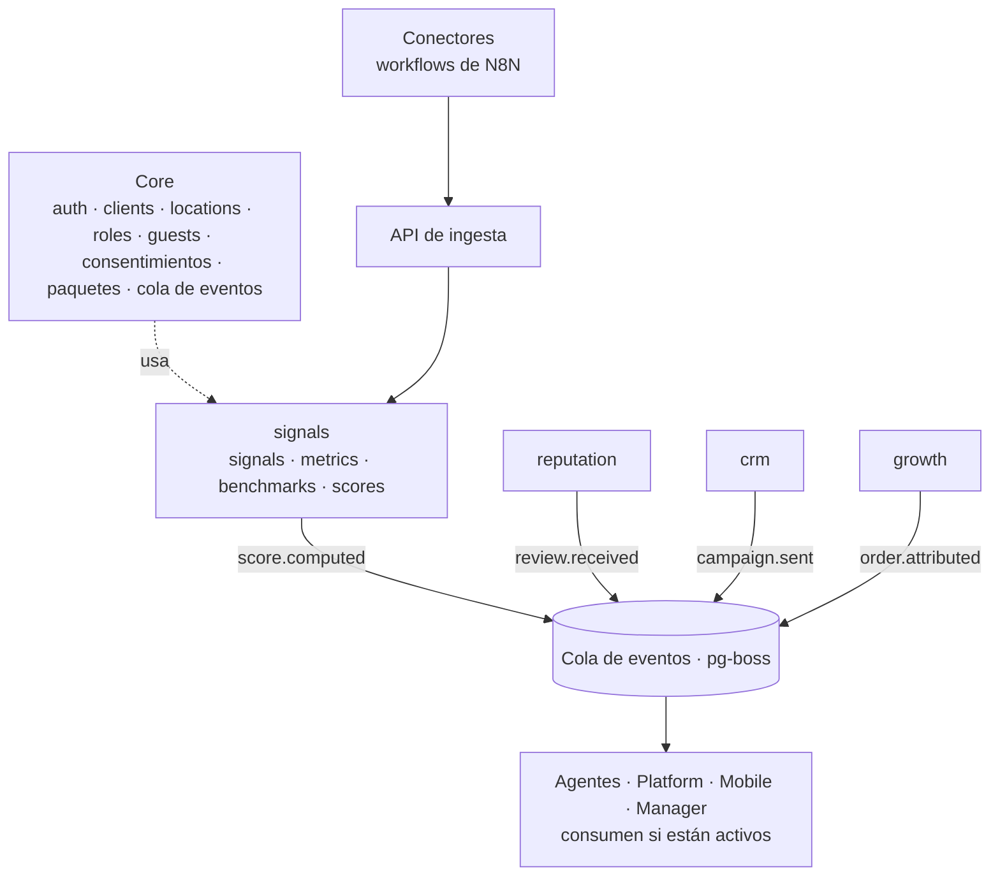

# Un monolito modular, *no microservicios*

Un solo sistema desplegable, dividido en módulos que no se conocen entre sí. Es la forma más simple de operar con un equipo pequeño, y cada módulo se puede separar en su propio servicio el día que haga falta sin reescribirlo.

## Las seis reglas de independencia

| # | Regla | Qué significa |
| --- | --- | --- |
| 1 | **Tablas propias** | Cada módulo tiene su esquema en Postgres. Ninguno lee ni escribe las tablas de otro. Usan la API pública de Core y leen métricas solo a través de la API de lectura del módulo `signals` |
| 2 | **Entradas propias** | Todo módulo funciona sin depender de otro: el CRM con una importación CSV, el módulo reputation con un QR y envío manual |
| 3 | **Solo eventos entre módulos** | Un módulo publica hechos (`review.received`). Quien quiera los consume. Si nadie escucha, no pasa nada |
| 4 | **Contratos versionados** | Cada evento tiene un esquema Zod con versión en `@atrium/contracts`. Cambiar un contrato es una versión nueva |
| 5 | **Encendido por client** | Cada módulo se activa por client y por local con un feature flag derivado del paquete |
| 6 | **Se prueba solo** | Cada módulo pasa sus pruebas sin que otro exista; las integraciones se prueban contra el contrato |

Una regla de CI (dependency-cruiser) rompe el build si un módulo importa el código de otro. La independencia no depende de la disciplina.

## Un solo modelo de datos

Cada número que muestra cualquier superficie resuelve a una métrica construida desde signals diarias. Las integraciones no son un añadido posterior: Toast, Metricool, Resend, Google, Meta y el hub first-party son las fuentes que el sistema existe para leer. Un registro manual mantiene viva cada métrica cuando falta un conector. Ver [Datos](../data).

## Agentes con límites verificables

Los agentes actúan solo a través de herramientas MCP que exponen los mismos casos de uso que la interfaz, con un motor de políticas en el medio. Ver [Agentes y MCP](./agents-and-mcp).
