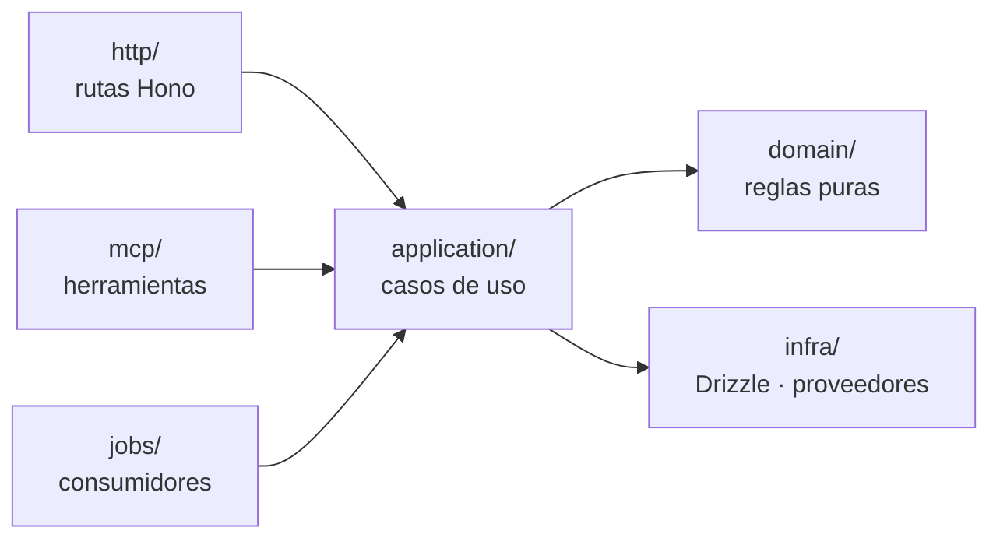

# Repositorio y *forma de un módulo*

```text
atrium/
├─ apps/
│  ├─ platform/       # Next.js 16 · el dashboard del client (Growth OS)
│  ├─ manager/        # Next.js 16 · la app de la agencia (Agency OS)
│  ├─ hub/            # Next.js 16 · hub, flujo de encuestas, páginas públicas
│  ├─ mobile/         # Expo · la app del dueño
│  ├─ api/            # Hono · monta las rutas de cada módulo, API de ingesta
│  ├─ worker/         # pg-boss · eventos, rollups, scoring, envíos
│  ├─ agents/         # runtime de agentes + gateway MCP
│  └─ docs/           # esta documentación (Docusaurus)
├─ connectors/        # exports de workflows de N8N, una carpeta por proveedor
├─ modules/
│  ├─ core/           # auth, clients, locations, guests, consentimientos, paquetes
│  ├─ signals/        # signals, metrics, benchmarks, scores
│  │  ├─ domain/          # reglas puras, sin IO
│  │  ├─ application/     # casos de uso
│  │  ├─ infra/           # Drizzle, proveedores
│  │  ├─ http/            # rutas Hono
│  │  ├─ jobs/            # consumidores de eventos, rollups
│  │  ├─ mcp/             # herramientas para agentes
│  │  ├─ agents/          # manifiestos de subagentes
│  │  ├─ migrations/
│  │  └─ tests/
│  ├─ discoverability/ # setup readiness, listings, botones del hub, salud del sitio
│  ├─ reputation/     # reseñas, respuestas, flujo de encuestas, casos de recuperación
│  ├─ crm/            # guestbook, segmentos, automatizaciones, campañas, lealtad
│  ├─ growth/         # programas, ofertas, campañas, atribución
│  ├─ content/        # registro de elements, pipeline, calendario, aprobaciones
│  ├─ ops/            # tareas, COG, ciclos, daily entry
│  ├─ reports/        # report builder, narrativa, archivo
│  └─ booker/         # diferido: reservas
├─ packages/
│  ├─ contracts/      # eventos y DTOs con Zod
│  ├─ scoring/        # funciones puras: normalización, mezclas, Growth Score
│  ├─ policy/         # motor de políticas de agentes
│  ├─ ui/             # Base UI + Tailwind + tokens de marca
│  ├─ email/          # plantillas React Email
│  └─ config/         # tsconfig, biome, reglas de dependencias
└─ docs/adr/          # copia de los ADR en el repo
```

## Capas de un módulo



| Capa | Puede importar | No puede importar |
| --- | --- | --- |
| `domain/` | Nada fuera de sí misma, `packages/contracts` y `packages/scoring` | Base de datos, red, framework |
| `application/` | `domain/`, interfaces de `infra/`, APIs públicas de `core` y `signals` | Otros módulos |
| `infra/` | `domain/`, Drizzle, SDKs de proveedores | Otros módulos |
| `http/`, `mcp/`, `jobs/` | `application/` | `infra/` directo, otros módulos |

:::tip Una sola lógica, tres puertas
La interfaz (`http/`), los agentes (`mcp/`) y los eventos (`jobs/`) llaman a los mismos casos de uso. Un agente nunca puede hacer algo que una persona con ese rol no pueda.
:::

## Reglas de la base

- Toda consulta pasa por un repositorio que exige el `client_id`; RLS en Postgres es la segunda defensa.
- Cada decisión técnica importante queda en un [ADR](../adr).
- Nada llega a `main` sin revisión, CI en verde y migraciones probadas. Ver [Definición de hecho](../guides/definition-of-done).
