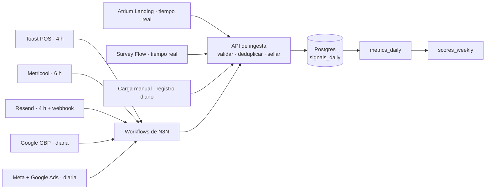

# Almacenamiento y *la tubería*

Seis tablas en un solo Postgres. Todo cae en `signals_daily`; todo lo demás se construye desde ahí.

## Tablas

| Tabla | Grano | Columnas | Notas |
| --- | --- | --- | --- |
| `signals_daily` | 1 fila / signal / día | `date`, `location_id`, `source`, `platform`, `element_id?`, `signal_type`, `value`, `meta`, `guest_id?` | El átomo. Todo cae aquí: conectores, webhooks acumulados cada noche, cargas manuales, agent grades |
| `metrics_daily` | 1 fila / métrica / día | `date`, `location_id`, `metric_id`, `value`, `engine`, `funnel_stage` | Rollups construidos desde `signals_daily`: lo que lee cada pantalla. Se reconstruyen de forma idempotente; nunca se editan a mano |
| `elements` | 1 fila / element | `element_id`, `type`, `platform`, `title`, `status`, `published_at`, `offer_id?` | El registro de piezas individuales: posts, emails, ads, ofertas, botones del hub. Las signals se unen por `element_id` |
| `benchmarks_monthly` | 1 fila / métrica / mes | `month`, `metric_id`, `radius_value`, `sample_size` | Promedios del radio de 10 millas. Nulable: una métrica sin benchmark igual se muestra, solo sin la marca ámbar |
| `agent_grades` | 1 fila / criterio / semana | `week`, `engine`, `criterion`, `grade` (0–4), `agent_id`, `evidence` | La mitad cualitativa. La escriben solo los agentes; el Account Manager puede corregirla con una nota |
| `scores_weekly` | 1 fila / engine / semana | `week`, `location_id`, `engine`, `measured`, `practice`, `score`, `bench_score` | Mezcla 60/40 por engine, más la fila del Growth Score compuesto (`engine = all`) |

Todas las tablas llevan `client_id` y están cubiertas por las pruebas de aislamiento. `signals_daily` se particiona por mes.

## Conectores

Los conectores llevan los datos de cada proveedor a `signals_daily`.

| Conector | Trae | Cadencia |
| --- | --- | --- |
| Toast POS | Órdenes, revenue, guests, suscriptores, desempeño del menú | cada 4 h |
| Metricool | Todas las redes sociales más paid social y search | cada 6 h |
| Resend | Email y automatizaciones | 4 h + webhook |
| Google GBP | Acciones del perfil, reseñas, ranking local | diaria |
| Atrium Landing | Sesiones del hub y cada toque de botón, etiquetados por fuente | tiempo real |
| Survey Flow | Notas post-orden, altas por QR | tiempo real |
| Carga manual | Órdenes, leads de catering y RSVPs que el Account Manager carga a mano | registro diario |

Los workflows de N8N son la capa de conectores y nunca escriben directo en la base: llaman a una API de ingesta validada e idempotente, así que el aislamiento por tenant, la validación de esquema y la deduplicación viven en un solo lugar. Ver [ADR 0014](../adr/0014-n8n-connectors-with-ingestion-api). La ingesta es idempotente sobre la clave natural (`date`, `location_id`, `source`, `platform`, `element_id`, `signal_type`); una nueva corrida reemplaza el día.

## Identity stitching

Los solapamientos se resuelven con identity stitching: ID de pixel, cruce con POS y teléfono o email unen cada signal, así que un guest se cuenta una sola vez en todas las fuentes. Un escaneo de QR y la orden a la que llevó son el mismo guest y nunca se cuentan doble. Las cargas manuales caen en la misma tabla, con sello de hora y etiquetadas `source = manual`.

## Reglas de operación

- **Particiones.** `signals_daily` tiene una partición por mes. La ingestión crea la que falte cuando hace falta, y el worker mantiene listos el mes actual y los doce siguientes (job `signals.ensure_partitions`, el día 1 de cada mes a las 03:00 UTC). La base de datos rechaza fechas anteriores al 2020-01-01 y a más de unos 400 días hacia adelante. Solo el rol dueño puede leer una partición directamente; la aplicación lee la tabla padre, así que las políticas por fila siempre aplican.
- **Reemplazar un día.** Cada fila lleva una `revision`: 1 al insertarse, y +1 cada vez que una re-ejecución la reemplaza, de modo que los días corregidos son visibles.
- **Borrado.** Cuando se borra un guest, sus señales se quedan (los conteos son reales) y el consumidor `signals.erase_guest` limpia el `guest_id`, solo en ese client. La fila opaca del guest y el log de consentimientos (solo ids) se conservan.
- **Retención.** El ledger de idempotencia de los consumidores (`processed_events`) se poda a los 30 días con el job `core.prune_processed_events`, a diario a las 03:30 UTC. La aplicación nunca borra de `signals_daily`.

## Métodos de atribución

Cada dólar atribuido lleva su método, guardado en `meta`.

| Método | Cómo se hace el cruce | Confianza |
| --- | --- | --- |
| `code` | Un código de promo u oferta redimido en el POS | Verificada |
| `pixel` | Clic en un ad y orden en el sitio o en el pedido online | Verificada |
| `loyalty` | Teléfono o email de lealtad en la cuenta | Verificada |
| `card` | Cruce de tarjeta contra el POS | Cruzada |
| `estimate` | Órdenes on-premise cruzadas × ticket medio | Estimada, siempre etiquetada |
| `manual` | Cargada a mano por el Account Manager | Según lo cargado |

## Vistas de atribución

Channel → etapa del funnel → outcome, "cada acción rastreada hasta el canal que la ganó", en conteos y no en dólares. Tres opciones de tabla reemplazan al gráfico de cintas; el build elige una tras revisarlas con clients.

| Opción | Forma | Se lee como |
| --- | --- | --- |
| 1a Matriz de calor | Una fila por canal, una columna por etapa; el tono es el volumen | Dónde hace su trabajo cada canal |
| 1b Barras segmentadas con riel de outcomes | Una barra por canal dividida por etapa; los outcomes apilados a la derecha | Cuánto de cada canal se vuelve qué |
| 1c Rankings por etapa | Cuatro columnas ordenadas: quién gana cada etapa y en qué se convirtió | A quién reforzar, por etapa |
