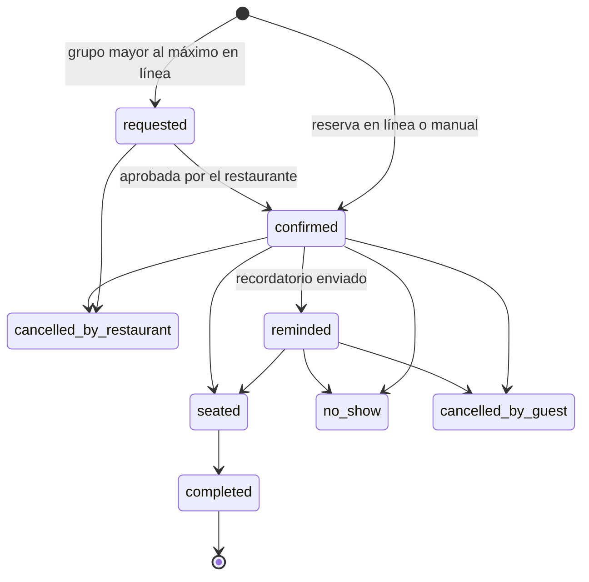

# Booker: reservas por *ritmo de cubiertos*

:::note Diferido
El primer lanzamiento rastrea las reservas con clics en reservar y links UTM, y atribuye las visitas que siguen. Un motor de reservas propio no es parte del plan actual. El diseño se conserva aquí para poder sumarlo sobre el mismo modelo. Ver [ADR 0012](../adr/0012-own-reservations-by-covers).
:::

El módulo diferido controla cuántas personas entran cada 15 minutos, no qué mesa ocupan, y deja el mapa de mesas para después.

## Configuración del location

| Parámetro | Ejemplo |
| --- | --- |
| Horario por día y turnos | Almuerzo 12:00–15:00, cena 18:00–22:30 |
| Intervalo | 15 min |
| Cubiertos máximos por intervalo | 16 |
| Duración por tamaño de grupo | 1–2: 75 min · 3–4: 90 min · 5–8: 120 min |
| Capacidad abierta en línea | 70% |
| Anticipación mínima / ventana máxima | 2 h / 30 días |
| Tamaño máximo en línea | 8 (más grande → solicitud) |

## Motor de disponibilidad

Lógica pura en `domain/`: dado un location, una fecha y un tamaño de grupo, devuelve los intervalos con cubiertos libres considerando la duración del grupo, la capacidad en línea y las reservas existentes. El primer paso del diseño es fijar si el tope es sobre llegadas por intervalo o sobre cubiertos sentados a la vez; los números del ejemplo no son una decisión.

:::warning Nunca se vende de más
La reserva se inserta en una transacción con bloqueo por location y fecha, y cada envío lleva una clave de idempotencia. Una prueba de carga con 50 reservas simultáneas al último intervalo debe terminar con 0 sobreventas.
:::

## Estados

## Cuándo se construye

Alimentaría directamente las signals de outcome `reservation`, que hoy vienen de los clics en reservar y del POS. Usaría el mismo botón del hub y el mismo flujo de encuestas.
