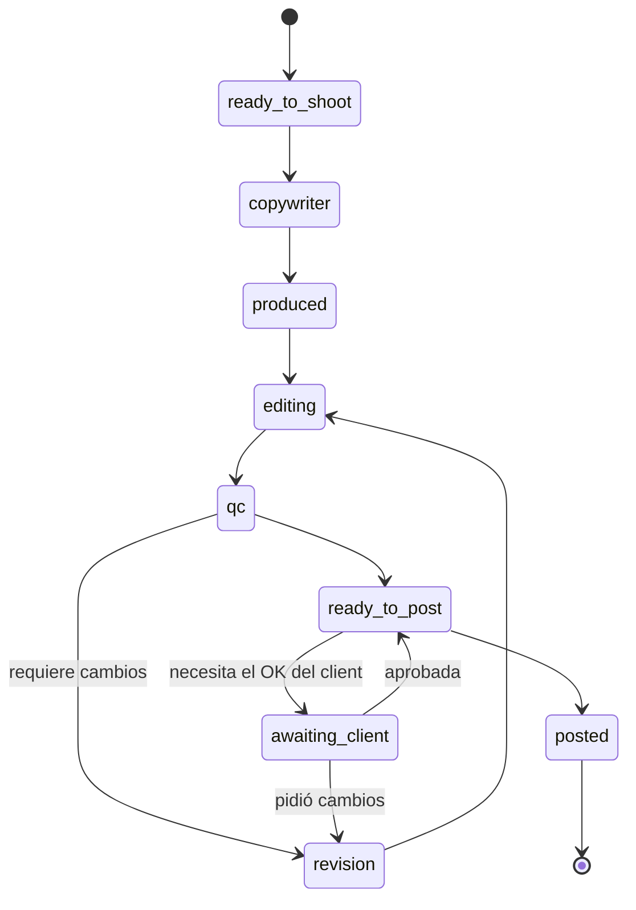

# Content: *la creatividad es el element*

El contenido es entrega y también es dato: cada post, reel y email es un element cuyas signals se atribuyen a esa pieza específica.

## Responsabilidades

| Área | Qué incluye |
| --- | --- |
| Registro de elements | Una fila por element: tipo, plataforma, título, estado, fecha de publicación y oferta; las signals se unen por `element_id` |
| Pipeline | Ocho estados de Ready to Shoot a Posted, cada uno con responsable; formato, origen (ciclo, extra, solicitud), etiqueta y su tope de tiempo |
| Calendario | Calendario de publicaciones, ready to post, líneas de tiempo de lotes de gráficos y reels, pendientes del día |
| Aprobaciones | La cola de aprobación del client: aprobar, pedir cambios; una pieza aprobada pasa al calendario |
| Biblioteca | Cada pieza en un solo lugar con su métrica |

## Estados

## Herramientas MCP

| Herramienta | Escribe | Nivel inicial |
| --- | --- | --- |
| `content.list_calendar` | No | 4 |
| `content.draft_item` | Sí (un borrador) | 2 |
| `content.propose_calendar` | Sí (una propuesta) | 2 |
| `content.publish_item` | Sí | 3 |

## Eventos

**Publica:** `content.status.changed`, `content.approved`, `content.published`.
**Consume:** `task.fired`.
