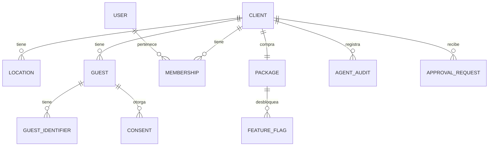

# Core, el único módulo *compartido*

Core contiene lo que todos los módulos necesitan y nada más. Los demás módulos usan su API pública; nunca sus tablas.

## Responsabilidades

| Área | Qué incluye |
| --- | --- |
| Identidad | Usuarios, organizaciones, roles, team roles, invitaciones (Better Auth) |
| Tenancy | Clients, locations, zona horaria, marca (logo, colores), la definición del radio de 10 millas |
| Paquetes | El paquete del client y la matriz de acceso, publicada como feature flags por módulo y por local |
| Guests | Identidad única por client; email y teléfono normalizados; deduplicación; los identificadores que usa el identity stitching |
| Consentimientos | Por canal (`email`) y propósito (`transactional`, `marketing`), con fecha, origen y baja |
| Cola de eventos | Publicación transaccional con pg-boss; registro de consumidores |
| Notificaciones | Envío de email transaccional con Resend, con bandeja de salida en texto plano y estados de entrega |
| Agentes | Registro de auditoría, cola de aprobaciones, interruptores |

## Entidades

## API pública (para otros módulos)

| Función | Para qué |
| --- | --- |
| `resolveGuest(clientId, {email?, phone?, name?})` | Devuelve el `guestId`, creándolo si no existe |
| `canContact(guestId, channel, purpose)` | Verifica consentimiento antes de cualquier envío |
| `recordConsent(guestId, channel, purpose, source)` | Registra un consentimiento o una baja, con su origen de opt-in |
| `publish(event, tx)` | Encola un evento dentro de la transacción del llamador |
| `isEnabled(clientId, locationId, module)` | Consulta un feature flag, derivado del paquete |
| `requestApproval(clientId, item)` | Pone una propuesta en la cola de aprobaciones |
| `sendNotification(template, to, data)` | Envía un mensaje transaccional |

## Notificaciones

El email es el único canal. Se envía con Resend detrás del puerto `NotificationTransport` ([ADR 0021](../adr/0021-resend-email-no-sms)). El transporte de Resend publica en la API REST de Resend con una clave de idempotencia. Una respuesta 4xx se registra como entrega `failed`; un 429, un 5xx, un tiempo agotado o una falla de red lanzan un error, así que quien llamó reintenta.

- **Bandeja de salida.** Cada envío se registra en `core.notifications` con la dirección enmascarada y solo el texto plano, nunca HTML.
- **Estados.** `recorded`, `sent`, `failed`, `delivered`, `bounced`, `complained`. Un estado nunca retrocede. Las aperturas y los clics todavía no se rastrean.
- **Webhook.** Resend llama a `POST /webhooks/resend`. La solicitud se verifica con su firma Svix (tolerancia de 5 minutos, límite de 256 KB) y actualiza el estado de la notificación.
- **Consentimiento.** Un rebote permanente o una queja retiran el consentimiento de email de ese guest (orígenes `email_bounce` y `email_complaint`). La baja se ejecuta antes de que el estado avance. Los rebotes transitorios o indeterminados no cambian nada.
- **Transporte.** Se construye con `RESEND_API_KEY` y `EMAIL_FROM`. El transporte de desarrollo, que registra y no envía nada, existe solo en desarrollo y pruebas. Fuera de ellos la API y el servicio de agentes se niegan a arrancar sin las variables de Resend. La API necesita además `RESEND_WEBHOOK_SECRET`; el servicio de agentes necesita además `PUBLIC_BASE_URL`, `AGENTS_SERVICE_TOKEN` (32 caracteres o más) y el mismo secreto de baja que la API (`SURVEY_SECRET`, con `BETTER_AUTH_SECRET` como respaldo).
