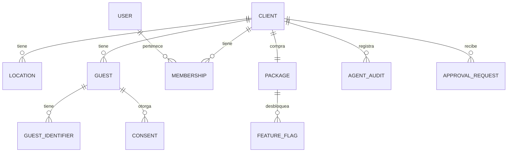

# Core, el único módulo *compartido*

Core contiene lo que todos los módulos necesitan y nada más. Los demás módulos usan su API pública; nunca sus tablas.

## Responsabilidades

| Área | Qué incluye |
| --- | --- |
| Identidad | Usuarios, organizaciones, roles, team roles, invitaciones (Better Auth) |
| Tenancy | Clients, locations, zona horaria, marca (logo, colores), la definición del radio de 10 millas |
| Paquetes | El paquete del client y la matriz de acceso, publicada como feature flags por módulo y por local |
| Guests | Identidad única por client; email y teléfono normalizados; deduplicación; los identificadores que usa el identity stitching |
| Consentimientos | Por canal (`email`, `sms`) y propósito (`transactional`, `marketing`), con fecha, origen y baja |
| Cola de eventos | Publicación transaccional con pg-boss; registro de consumidores |
| Notificaciones | Envío de mensajes transaccionales de email y SMS con plantillas |
| Agentes | Registro de auditoría, cola de aprobaciones, interruptores |

## Entidades

## API pública (para otros módulos)

| Función | Para qué |
| --- | --- |
| `resolveGuest(clientId, {email?, phone?, name?})` | Devuelve el `guestId`, creándolo si no existe |
| `canContact(guestId, channel, purpose)` | Verifica consentimiento antes de cualquier envío |
| `recordConsent(guestId, channel, purpose, source)` | Registra un consentimiento o una baja, con su origen de opt-in |
| `publish(event, tx)` | Encola un evento dentro de la transacción del llamador |
| `isEnabled(clientId, locationId, module)` | Consulta un feature flag, derivado del paquete |
| `requestApproval(clientId, item)` | Pone una propuesta en la cola de aprobaciones |
| `sendNotification(template, to, data)` | Envía un mensaje transaccional |
