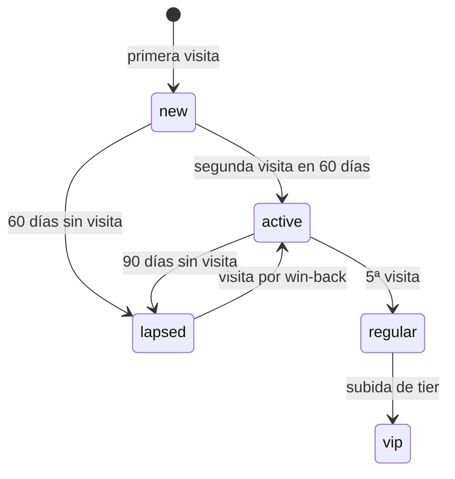

# CRM: *la relación propia*

El módulo detrás del engine Retention: el guestbook, los segmentos, las automatizaciones always-on, las campañas y el programa de lealtad, sobre Resend para email y Toast para el guest y la visita.

## Responsabilidades

| Área | Qué incluye |
| --- | --- |
| Captura | Opt-ins desde el POS, el portal WiFi, la encuesta por QR, y los checkouts de pedidos y reservas online; cada contacto conserva su origen |
| Guestbook | Un perfil por guest con visitas, valor de vida, etiqueta y última visita, desde el CRM de Toast |
| Segmentos | Regulares, lapsed, VIP, nuevos, cumpleaños, por origen del opt-in |
| Automatizaciones | Bienvenida de 24 h, cumpleaños, win-back a 60 días, lapsed a 90 días |
| Campañas | Email (2–4 al mes), segmentadas, con una ventana de revenue de 14 días |
| Lealtad | La tarjeta de sellos anónima, construida (ver abajo); tiers por visitas y reconocimiento VIP vienen después |
| Cohortes | Retención por mes desde la primera visita |

## Qué está construido

Hoy solo existe el núcleo de lealtad (`modules/crm`, esquema Postgres `crm`); el guestbook, los segmentos, las automatizaciones, las campañas y las cohortes son la entrega C. La guía [Lealtad y la tarjeta de sellos](../guides/loyalty-and-qr-card) explica cómo lo usa un local y el [ADR 0022](../adr/0022-loyalty-card-device-bound) registra las decisiones.

| Pieza | Estado |
| --- | --- |
| Programas, tarjetas, sellos, premios, canje y anulación | Construido, con seguridad por fila, bloqueo consultivo, idempotencia y auditoría |
| Opt-in de email con consentimiento (fuente `loyalty_card`) | Construido, sin verificar; el doble opt-in es la entrega C |
| Lista de actividad y cifras de la banda | Construido |
| Rutas de API públicas y del personal | Construido (`/v1/loyalty/*`, `/api/loyalty/*`, `/api/insights/loyalty`) |
| Borrado: una tarjeta se desvincula de un guest borrado | Construido, un consumidor en el worker |
| La página de la tarjeta y las pantallas de Platform y Manager | Entrega B |
| Pases de wallet | Entrega D |

## El modelo de lealtad

- **Un programa por local**: sellos necesarios (2 a 20), texto del premio, enfriamiento (0 a 1440 minutos), un color de acento, activo o en pausa.
- **Una tarjeta es anónima y pertenece a un dispositivo.** Tiene un token hasheado y un código corto de 8 caracteres. Un guest se vincula solo por el opt-in opcional de email; varias tarjetas pueden compartir un guest.
- **El progreso se deriva** de los eventos de solo agregar `stamp`, `reward_earned`, `reward_redeemed` y `void`; nada guarda un conteo corriente.
- **Soporte de Core:** Core exporta `userDisplayNames`, lleva la matriz de permisos `loyalty` (`read`, `stamp`, `redeem`, `manage`) y acepta la fuente de consentimiento `loyalty_card`.

## Reglas en código

- `canContact` se verifica en cada envío.
- Todo mensaje lleva baja; una baja es una signal y actualiza el registro de consentimientos al instante.

## Ciclo de vida del guest

## Herramientas MCP

| Herramienta | Escribe | Nivel inicial |
| --- | --- | --- |
| `crm.get_guest` | No | 4 |
| `crm.list_segment` | No | 4 |
| `crm.fire_automation` | Sí | 4 |
| `crm.draft_campaign` | Sí (borrador) | 2 |
| `crm.send_campaign` | Sí | 3 |
| `crm.recognize_milestone` | Sí | 4 |
| `crm.get_loyalty_card` | No | 4 |

`crm.get_loyalty_card` está construida en el módulo pero no está registrada en el servicio de agentes hasta la entrega C, cuando el agente de CRM tenga su manifiesto.

## Eventos

**Publica:** `loyalty.card.issued`, `loyalty.stamp.added`, `loyalty.reward.earned`, `loyalty.reward.redeemed` y `contact.captured` (construidos); `automation.fired`, `campaign.sent` (entrega C). `loyalty.reward.earned` es el nombre canónico y reemplaza al anterior `loyalty.milestone.reached`.
**Consume:** `guest.erased` (construido); `consent.changed`, `survey.response.submitted` (entrega C).

## Métricas

Tasa de guests recurrentes, miembros de lealtad, open rate y click rate (más adelante, con marketing y CRM), redenciones, retornos por win-back, revenue de email y bajas: las filas de Retention del [inventario de métricas](../data/metrics-and-scoring).
