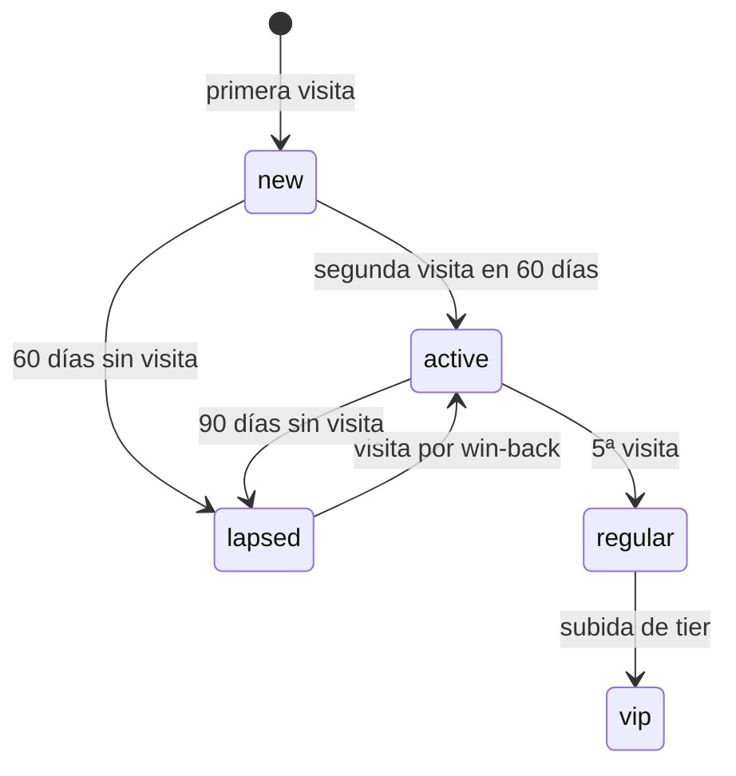

# CRM: *la relación propia*

El módulo detrás del engine Retention: el guestbook, los segmentos, las automatizaciones always-on, las campañas y el programa de lealtad, sobre Twilio para email y SMS y Toast para el guest y la visita.

## Responsabilidades

| Área | Qué incluye |
| --- | --- |
| Captura | Opt-ins desde el POS, el portal WiFi, la encuesta por QR, y los checkouts de pedidos y reservas online; cada contacto conserva su origen |
| Guestbook | Un perfil por guest con visitas, valor de vida, etiqueta y última visita, desde el CRM de Toast |
| Segmentos | Regulares, lapsed, VIP, nuevos, cumpleaños, por origen del opt-in |
| Automatizaciones | Bienvenida de 24 h, cumpleaños, win-back a 60 días, lapsed a 90 días |
| Campañas | Email (2–4 al mes) y SMS (1–2 al mes más ofertas flash), segmentadas, con ventanas de revenue de 14 días para email y 7 días para SMS |
| Lealtad | Tiers por visitas, reconocimiento VIP y el hito de 5 visitas |
| Cohortes | Retención por mes desde la primera visita |

## Reglas en código

- `canContact` se verifica en cada envío; el SMS tiene tope de 2 por semana por suscriptor.
- Todo mensaje lleva baja; una baja es una signal y actualiza el registro de consentimientos al instante.
- El SMS requiere un registro 10DLC aprobado para el client.

## Ciclo de vida del guest

## Herramientas MCP

| Herramienta | Escribe | Nivel inicial |
| --- | --- | --- |
| `crm.get_guest` | No | 4 |
| `crm.list_segment` | No | 4 |
| `crm.fire_automation` | Sí | 4 |
| `crm.draft_campaign` | Sí (borrador) | 2 |
| `crm.send_campaign` | Sí | 3 |
| `crm.recognize_milestone` | Sí | 4 |

## Eventos

**Publica:** `contact.captured`, `automation.fired`, `campaign.sent`, `loyalty.milestone.reached`.
**Consume:** `consent.changed`, `survey.response.submitted`.

## Métricas

Tasa de guests recurrentes, miembros de lealtad, open rate, click rate, redenciones, retornos por win-back, revenue de email y SMS y bajas: las filas de Retention del [inventario de métricas](../data/metrics-and-scoring).
