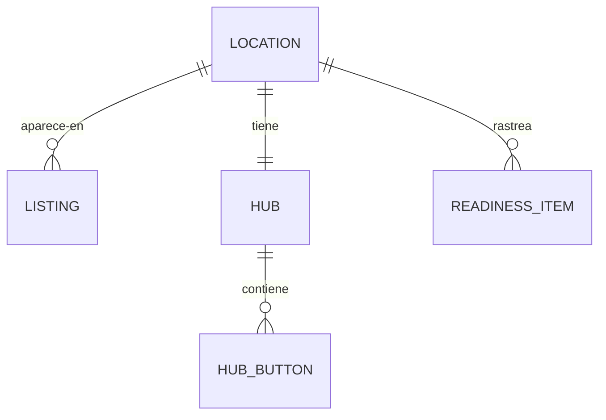

# Discoverability: *armado para ser encontrado*

El módulo que mantiene correcta la puerta digital. Guarda el checklist cuyos puntos forman el score de setup readiness, el estado de cada listing, la configuración del hub y la salud de las etiquetas del sitio.

## Responsabilidades

| Área | Qué incluye |
| --- | --- |
| Setup readiness | Ítems por categoría (GBP, listings, SEO, perfiles, links, pixels), cada uno con puntos según los servicios que corren; la suma es el readiness de 0–100 |
| Listings | Google Business Profile, Apple Maps, Yelp, Facebook, TripAdvisor, Bing Places y apps de delivery: estado (synced, fix hours, missing) y el último chequeo |
| Hub | La página de links del restaurante: botones (pedir, reservar, indicaciones, llamar, menú, sitio), su orden y etapa, manejo de UTM y la página pública |
| Salud del sitio | Schema presente, link al menú activo, pixel disparando, salud del link de bio |

## Entidades

## Herramientas MCP

| Herramienta | Escribe | Nivel inicial |
| --- | --- | --- |
| `discoverability.list_listings` | No | 4 |
| `discoverability.get_readiness` | No | 4 |
| `discoverability.propose_listing_fix` | Sí (una propuesta) | 2 |
| `discoverability.update_gbp` | Sí | 3 |
| `discoverability.update_hub_button` | Sí | 3 |

## Eventos

**Publica:** `listing.drift.detected`, `hub.button.updated`.
**Consume:** `package.changed`.

Los toques de los botones del hub son signals, escritas en `signals_daily` con la fuente `landing`.
