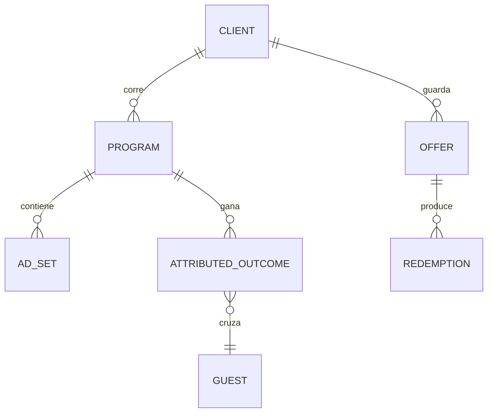

# Growth: *cada dólar, rastreado hasta una orden*

El módulo detrás del engine Growth. Planifica y rastrea programas de paid, guarda las ofertas que el restaurante pone detrás del marketing y atribuye cada orden y reserva a su fuente con su método.

## Responsabilidades

| Área | Qué incluye |
| --- | --- |
| Programas always-on | Los tres buckets donde cae cada dólar de ads permanentes: on-premise (estimado), órdenes online y reservas, cada uno con meta, resultado, presupuesto y ritmo |
| Campañas a medida | Eventos, catering y acciones únicas con su propia meta y presupuesto |
| Ofertas | La promoción, sus términos, su estado y cada redención, convertidas en ads, reels, email, SMS y en el local |
| Atribución | Identity stitching, los métodos de atribución, channel → etapa → outcome y source → journey → outcome |
| Ritmo | Gasto contra presupuesto con una proyección al cierre del período |

## Entidades

## Reglas en código

- Una estimación es un campo, no una nota al pie: `on-premise sales` se guarda con `method = estimate`.
- Un lanzamiento, un movimiento de presupuesto o una afirmación de precio o menú crea una solicitud de aprobación.
- El ROAS que se muestra de un programa es `ventas ÷ gasto` sobre el mismo rango, con las ventas divididas en verificadas y estimadas.

## Herramientas MCP

| Herramienta | Escribe | Nivel inicial |
| --- | --- | --- |
| `growth.get_pacing` | No | 4 |
| `growth.attribute_order` | Sí (con su método) | 4 |
| `growth.propose_campaign` | Sí (una propuesta) | 2 |
| `growth.brief_creative` | Sí (un brief) | 2 |
| `growth.shift_budget` | Sí | 3 (se queda en 3) |

## Eventos

**Publica:** `campaign.launched`, `budget.pacing.alert`, `offer.redeemed`, `order.attributed`.
**Consume:** `guest.identified`, `campaign.sent`, `content.published`.

## Métricas

Gasto, impresiones pagas, clics, órdenes y reservas de ads, órdenes on-premise cruzadas, ventas on-premise (estimadas), ROAS, costo por acción y leads: las filas de Growth del [inventario de métricas](../data/metrics-and-scoring).
