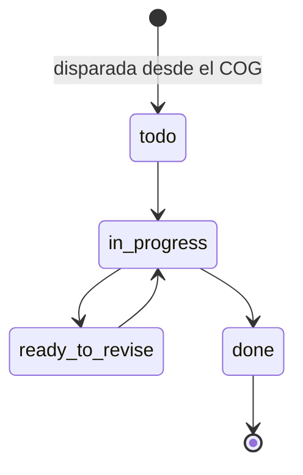

# Ops: *la promesa, expresada en unidades*

El módulo que convierte la promesa de un client en trabajo. El COG lista unidades medibles y entregables; el calendario del ciclo dispara las tareas; el daily entry registra lo que se entregó.

## Responsabilidades

| Área | Qué incluye |
| --- | --- |
| COG | Equipo de la cuenta, alcance por grupo, calendario del ciclo, volumen de trabajo, topes por etiqueta, guardrails permanentes, reglas semanales permanentes, estado del tech stack, fechas clave y la bitácora de cambios |
| Ciclos | El ciclo mensual anclado a la fecha de facturación; la etapa vigente |
| Tareas | Naturaleza de la etapa, tipo de tarea, estado, responsable, horas estándar y reales, estado de vencimiento; disparadas desde el COG por el Account Manager |
| Daily entry | Un registro manual con sello de hora por client, con las secciones que desbloquea el paquete; escribe `signals_daily` con `source = manual` |
| Capacidad | Horas estándar por rol contra las personas asignadas |

## Estados

## Herramientas MCP

Ninguna. Ops lo operan personas; los agentes leen el COG con `ops.get_cog` (nivel 4) para que sus guardrails coincidan con los del client.

## Eventos

**Publica:** `task.fired`, `task.completed`, `cycle.started`.
**Consume:** `content.status.changed`.
