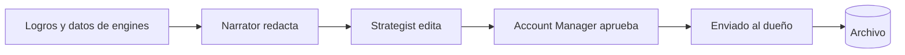

# Reports: *la historia del mes*

El módulo que convierte un mes de datos en el documento que lee el client. Arma el reporte desde los logros y los datos de cada engine, escribe la narrativa y guarda el archivo.

## Responsabilidades

| Área | Qué incluye |
| --- | --- |
| Report builder | Elegir qué engines incluir (por ejemplo, Retention apagado para un client Essential), el rango y el formato; armar y descargar, o programar cada mes |
| Wins | Logros recolectados todo el mes por los agentes (el mejor post, una story que trajo indicaciones, un email de regulares), los momentos que vale la pena poner en el reporte |
| Narrativa | Una historia corta generada con los datos del mes, editada por el strategist antes de enviarse |
| Archivo | Cada reporte enviado, con su fecha y destinatario |
| Roadmap | El plan de 90 días atado a metas y temporada |

## Flujo

## Herramientas MCP

| Herramienta | Escribe | Nivel inicial |
| --- | --- | --- |
| `reports.get_wins` | No | 4 |
| `reports.draft_report` | Sí (un borrador) | 3 (una persona aprueba antes de enviarlo) |
| `reports.draft_roadmap` | Sí (un borrador) | 2 |

## Eventos

**Publica:** `report.generated`, `report.sent`.
**Consume:** `score.computed`, `order.attributed`, `content.published`.
