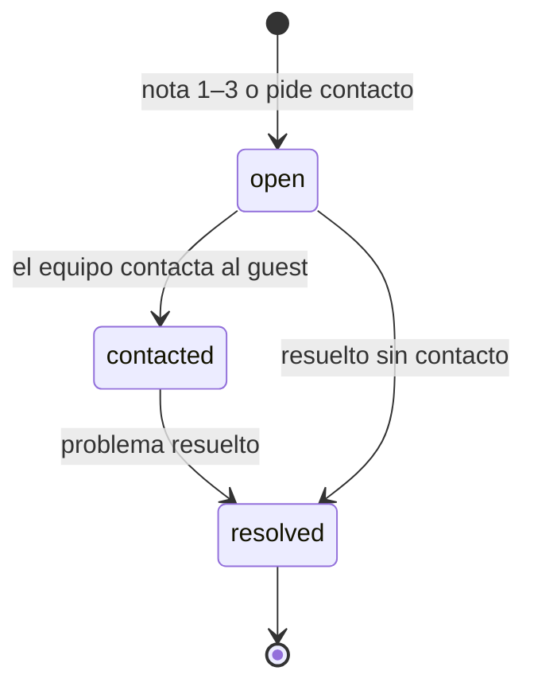

# Reputation: reseñas, respuestas y una *encuesta de menos de un minuto*

El módulo detrás del engine Reputation. Guarda reseñas y respuestas, corre el flujo de encuestas que detecta los problemas a tiempo y abre casos de recuperación. Funciona solo con un QR en la mesa.

## Responsabilidades

| Área | Qué incluye |
| --- | --- |
| Reseñas | Reseñas de Google, Yelp y otras, con rating, texto, estado de respuesta y demora; temas |
| Respuestas | Redactar, aprobar y publicar en la voz de la marca; las negativas necesitan la aprobación escrita del Account Manager |
| Flujo de encuestas | La encuesta post-visita, QR por local y links firmados de un solo uso |
| Pedidos de reseña | Enviados a todos los guests tras una visita, ajustados al momento feliz |
| Casos de recuperación | Abierto, contactado, resuelto, con la meta de primera respuesta de 24 h |

## Cómo llega la encuesta

| Entrada | Detalle |
| --- | --- |
| QR por local | En tent cards y recibos; anónima, con límite de envíos por dispositivo |
| Post-orden | Tras una orden el guest puede escanear o tocar; la orden vincula la respuesta al guest cuando se conoce |
| Envío manual | A un guest con consentimiento, desde el Manager |
| Importar CSV | Lista de guests con consentimiento registrado |

Cada invitación es un link firmado de un solo uso que vence en 7 días.

## Preguntas (plantilla v1)

1. ¿Cómo fue tu visita? — de 1 a 5
2. ¿Qué fue lo mejor? — opciones rápidas
3. ¿Qué podemos mejorar? — opciones rápidas
4. Comentario libre, opcional
5. ¿Quieres que el gerente te contacte? — opcional, y solo entonces pide un teléfono o email

La plantilla es versionada: cambiar preguntas no rompe respuestas anteriores. Una respuesta anónima nunca abre un caso que requiera datos de contacto a menos que el guest los deje.

## Pantalla final

:::danger Regla del sistema
Todos ven el botón para dejar reseña en Google, sin importar su calificación. El link lo agrega el sistema y nunca depende de la respuesta. El canal privado se ofrece además, nunca en lugar. Ver [ADR 0018](../adr/0018-no-review-gating).
:::

Todos ven también la opción de hablar con el gerente. El clic en reseña se registra como signal.

## Casos de recuperación

Alerta inmediata por email al dueño y al Account Manager. Una reseña pública nunca se vincula a un guest por suposición: un caso se abre desde una respuesta de encuesta, o cuando el Account Manager vincula la reseña.

## Herramientas MCP

| Herramienta | Escribe | Nivel inicial |
| --- | --- | --- |
| `reputation.list_reviews` | No | 4 |
| `reputation.list_responses` | No | 4 |
| `reputation.classify_response` | Sí (etiquetas) | 4 |
| `reputation.open_case` | Sí | 4 |
| `reputation.draft_reply` | Sí (borrador) | 2 |
| `reputation.publish_reply` | Sí | 3 (las negativas se quedan en 3) |
| `reputation.send_review_request` | Sí | 4 |

## Eventos

**Publica:** `review.received`, `review.replied`, `survey.sent`, `survey.response.submitted`, `recovery.case.opened`, `recovery.case.resolved`, `review.link.clicked`.
**Consume (opcional):** `contact.captured`.

## Métricas

Tasa de respuesta, tiempo de respuesta, rating, velocidad de reseñas, parte de 5 estrellas, conversión del pedido de reseña y score de encuesta: las filas de Reputation del [inventario de métricas](../data/metrics-and-scoring).
