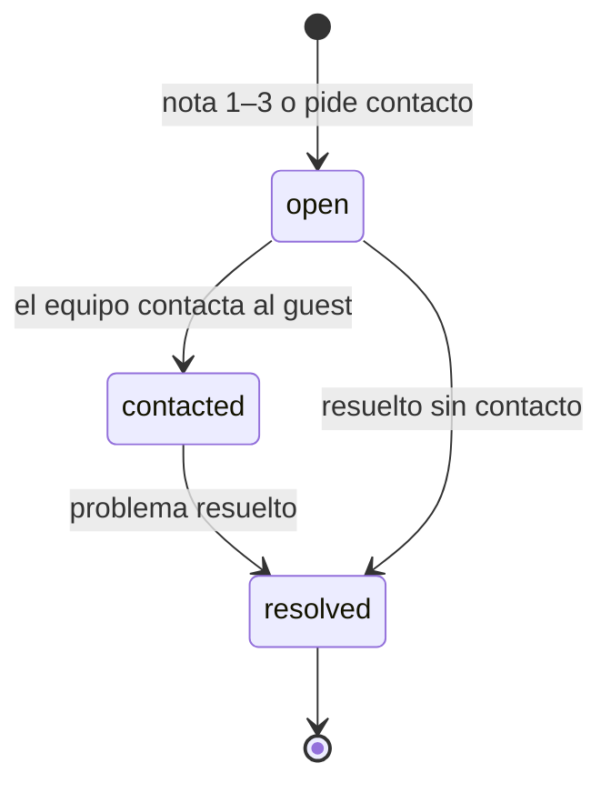

# Reputation: reseñas, respuestas y una *encuesta de menos de un minuto*

El módulo detrás del engine Reputation. Guarda reseñas y respuestas, corre el flujo de encuestas que detecta los problemas a tiempo y abre casos de recuperación. Funciona solo con un QR en la mesa.

## Responsabilidades

| Área | Qué incluye |
| --- | --- |
| Reseñas | Reseñas de Google, Yelp y otras, con rating, texto, estado de respuesta y demora; temas |
| Respuestas | Redactar, aprobar y publicar en la voz de la marca; las negativas necesitan la aprobación escrita del Account Manager |
| Flujo de encuestas | La encuesta post-visita, QR por local y links firmados de un solo uso |
| Pedidos de reseña | Enviados a todos los guests tras una visita, ajustados al momento feliz |
| Casos de recuperación | Abierto, contactado, resuelto, con la meta de primera respuesta de 24 h |

## Cómo llega la encuesta

| Entrada | Detalle |
| --- | --- |
| QR por local | En tent cards y recibos; anónima, con límite de envíos por dispositivo |
| Post-orden | Tras una orden el guest puede escanear o tocar; la orden vincula la respuesta al guest cuando se conoce |
| Envío manual | A un guest con consentimiento, desde el Manager |
| Importar CSV | Lista de guests con consentimiento registrado |

Cada invitación es un link firmado de un solo uso que vence en 7 días.

## Preguntas (plantilla v1)

1. ¿Cómo fue tu visita? — de 1 a 5
2. ¿Qué fue lo mejor? — opciones rápidas
3. ¿Qué podemos mejorar? — opciones rápidas
4. Comentario libre, opcional
5. ¿Quieres que el gerente te contacte? — opcional, y solo entonces pide un teléfono o email

La plantilla es versionada: cambiar preguntas no rompe respuestas anteriores. Una respuesta anónima nunca abre un caso que requiera datos de contacto a menos que el guest los deje.

## Pantalla final

:::danger Regla del sistema
Todos ven el botón para dejar reseña en Google, sin importar su calificación. El link lo agrega el sistema y nunca depende de la respuesta. El canal privado se ofrece además, nunca en lugar. Ver [ADR 0018](../adr/0018-no-review-gating).
:::

Todos ven también la opción de hablar con el gerente. El clic en reseña se registra como signal.

## Casos de recuperación

Alerta inmediata por email al dueño y al Account Manager. Una reseña pública nunca se vincula a un guest por suposición: un caso se abre desde una respuesta de encuesta, o cuando el Account Manager vincula la reseña.

## Leer las palabras de los guests

Cuando se envía una respuesta, el subagente Sentiment lee el comentario y las dos opciones elegidas con un modelo de lenguaje ([0019](../adr/0019-llm-provider-behind-a-port)) y guarda etiquetas internas en la respuesta: sentimiento, temas, un nivel de preocupación (bajo, medio o alto) y una marca de seguridad. La herramienta es `reputation.read_response`, y la lectura termina con el evento `survey.response.read`. En los eventos viajan solo etiquetas, nunca el texto del guest.

Recovery escucha ambos eventos y decide por su cuenta: una lectura abre un caso cuando la preocupación es media o alta, o cuando la marca de seguridad está activa. La severidad solo escala: un caso toma la mayor entre la de la calificación y la de la lectura, y si ya existe uno para la respuesta se sube, nunca se baja. Sentiment no puede abrir un caso, avisar a nadie ni tocar el link de reseña.

Nada de esto cambia a quién se le pide reseña. El botón de Google nunca depende de la calificación ni de la lectura ([0018](../adr/0018-no-review-gating)). Si el modelo falla o no está disponible, la respuesta queda sin leer y Recovery sigue funcionando con la calificación. Agrupar temas entre respuestas a diario es trabajo posterior, junto con el dashboard.

El tope diario de Sentiment (500 lecturas) también cuenta las respuestas sin comentario. Una respuesta rechazada por el tope queda sin leer; volver a leer respuestas antiguas queda fuera del alcance.

## Pedidos de ayuda como conversaciones

Un pedido de ayuda es un hilo entre el cliente y la agencia, no una nota de un solo envío. El cliente lo abre desde el Manager (Help) con un primer mensaje, que es obligatorio, y la agencia responde en el mismo hilo desde la Platform o el Manager. Cada mensaje lleva su autor, el lado del autor (cliente o agencia) y la hora. Los pedidos antiguos sin nota muestran el texto provisional `(no message)`.

| Rol | Lee | Escribe | Cierra |
| --- | --- | --- | --- |
| `client_owner` | Sí | Sí | Solo como Resuelto |
| `agency_admin` | Sí | Sí | Resuelto o Rechazado |
| `account_manager` | Sí | Sí | Resuelto o Rechazado |
| `agency_staff` | Sí | No | No |
| `client_staff` | Sin acceso | No | No |

Un mensaje publicado en un caso cerrado lo reabre, así que una respuesta después de Resuelto devuelve el hilo a En espera. Un pedido cerrado dos veces responde `409 invalid_state`.

Un mensaje puede llevar un adjunto, de dos tipos:

- **Una respuesta de encuesta**, mostrada como una tarjeta con la calificación, el comentario, las etiquetas del agente, la fecha y el local. La tarjeta nunca muestra datos de contacto. En la Platform, Responses tiene "Ask for help about this", que abre Help con la respuesta ya adjunta.
- **Una reseña externa**, como un link `https` más texto y estrellas opcionales.

Cada mensaje avisa al otro lado con el tipo `reputation.help_message`. La notificación lleva una vista previa de como máximo 140 caracteres y enlaza al hilo. La lista y el hilo abierto se actualizan cada 15 segundos mientras la pestaña está visible.

La API reemplazó `POST /surveys/requests/:id/handle` por `GET /surveys/requests/:id`, `POST /surveys/requests/:id/messages`, `POST /surveys/requests/:id/close` y `GET /surveys/responses/pickable`.

Fuera del alcance: archivos adjuntos, tiempo real, contadores de no leídos, editar o borrar mensajes, y agentes que participen en los hilos.

## Herramientas MCP

| Herramienta | Escribe | Nivel inicial |
| --- | --- | --- |
| `reputation.list_reviews` | No | 4 |
| `reputation.list_responses` | No | 4 |
| `reputation.classify_response` | Sí (etiquetas) | 4 |
| `reputation.read_response` | Sí (etiquetas) | 4 |
| `reputation.open_case` | Sí | 4 |
| `reputation.draft_reply` | Sí (borrador) | 2 |
| `reputation.publish_reply` | Sí | 3 (las negativas se quedan en 3) |
| `reputation.send_review_request` | Sí | 4 |

## Eventos

**Publica:** `review.received`, `review.replied`, `survey.sent`, `survey.response.submitted`, `survey.response.read`, `recovery.case.opened`, `recovery.case.resolved`, `review.link.clicked`.
**Consume (opcional):** `contact.captured`.

## Métricas

Tasa de respuesta, tiempo de respuesta, rating, velocidad de reseñas, parte de 5 estrellas, conversión del pedido de reseña y score de encuesta: las filas de Reputation del [inventario de métricas](../data/metrics-and-scoring).
