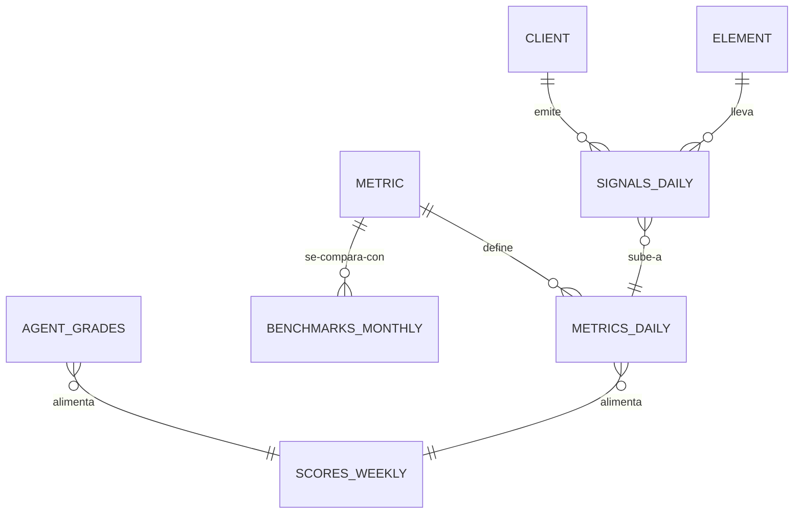

# Signals: *la columna vertebral de datos*

El módulo `signals` es dueño de las seis tablas del [modelo de datos](../data/storage-and-pipeline) y de la API de lectura que usan todas las superficies. Es el primer módulo que se construye después de Core, porque todos los demás módulos y todos los agentes leen de él.

## Responsabilidades

| Área | Qué incluye |
| --- | --- |
| Ingesta | Una API validada e idempotente para conectores, fuentes first-party y cargas manuales; los valores de `signal_type` desconocidos se rechazan |
| Signals | `signals_daily`, particionada por mes; unificación por `guest_id` |
| Metrics | El registro de métricas (el inventario) y el job de rollup que reconstruye `metrics_daily` de forma idempotente |
| Benchmarks | `benchmarks_monthly` con tamaño de muestra por métrica; solo agregados |
| Grades | `agent_grades` escritas por subagentes observadores, con la corrección y nota del Account Manager |
| Scores | `scores_weekly`: measured, practice, score, el score del radio y la fila del Growth Score |
| API de lectura | Matemática de rangos sobre filas diarias: sum, trend, rate, latest, compare, score, por local |

## Entidades



## Contrato de ingesta

```ts title="packages/contracts/src/signals.ts"
export const SignalRowV1 = z.object({
  date: z.string().date(),
  locationId: z.string().uuid(),
  source: z.enum(['metricool', 'gbp', 'landing', 'site', 'toast',
    'meta_ads', 'google_ads', 'survey', 'review', 'manual', 'agent']),
  platform: z.enum(['instagram', 'facebook', 'tiktok', 'youtube', 'google', 'meta']).optional(),
  elementId: z.string().optional(),
  signalType: SignalType,            // el enum canónico
  value: z.number(),
  meta: z.record(z.unknown()).optional(),
  guestId: z.string().optional(),
});
```

## Herramientas MCP

| Herramienta | Escribe | Nivel inicial |
| --- | --- | --- |
| `signals.get_scores` | No | 4 |
| `signals.get_metric` | No | 4 |
| `signals.list_alerts` | No | 4 |
| `signals.write_grade` | Sí (una practice grade con evidencia) | 4 |

## Eventos

**Publica:** `signals.ingested`, `metrics.rebuilt`, `score.computed`, `benchmark.updated`, `grade.written`.
**Consume:** `package.changed`.

## Métricas

Frescura por fuente, filas ingeridas y rechazadas, duración del rollup y proporción de métricas con benchmark.
