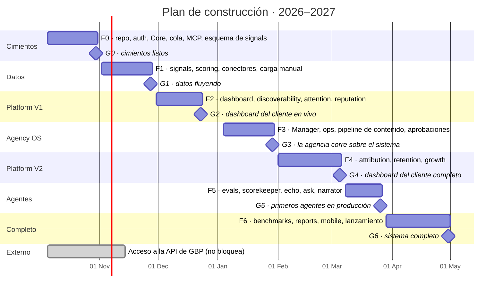

# Cimientos en cuatro semanas, *datos en ocho*, un dashboard para el cliente antes de Navidad

Calendario con un desarrollador trabajando con Claude Code, empezando el lunes 5 de octubre de 2026. El plan está ordenado por lo que todo lo demás necesita: primero los datos, porque cada pantalla, cada score y cada agente los lee; después el dashboard del cliente, luego las herramientas de la agencia y por último las capas que necesitan a ambos. Con dos desarrolladores, las fases F2 y F3, y las fases F5 y F6, corren en paralelo y el total baja a unas 20 semanas.

| Fase | Fechas | Qué se entrega |
| --- | --- | --- |
| **F0 · Cimientos** | 5–30 oct | Repo con Bun, CI/CD, entornos, auth con organizaciones y team roles, Core (guests, consentimientos, paquetes, cola de eventos, aprobaciones, auditoría), gateway MCP y motor de políticas, UI base, el esquema de signals y la API de ingesta |
| **F1 · Columna de datos** | 2–27 nov | Registro de métricas, rollups, paquete de scoring, benchmarks, agent grades, carga manual diaria, N8N con Toast, Metricool, Google Business Profile, Meta Ads y Google Ads |
| **F2 · Platform V1** | 30 nov–23 dic | El shell de la Platform, Dashboard, Discoverability, Attention y Reputation, el hub, el flujo de encuestas y el feed de reseñas; 2 clients en piloto con datos reales |
| **F3 · Agency OS** | 4–29 ene | El Manager: cartera, workspace por client, COG, tareas disparadas desde él, pipeline de contenido, estudio, aprobaciones, daily entry y estado de datos; la sección Management de la Platform |
| **F4 · Platform V2** | 1 feb–5 mar | Attribution con identity stitching, Retention por email con Resend, programas y ofertas de Growth, acceso por paquete aplicado |
| **F5 · Agentes** | 8–26 mar | Harness de evals, calificación de práctica, Scorekeeper, Echo, Ask, Sentiment, Narrator y Strategist en producción |
| **F6 · Completo** | 29 mar–30 abr | Benchmarks, Reporting y Settings, el report builder, la app del dueño en Mobile, calibración de pesos, migración de la cartera |

Los cimientos llevan cuatro semanas porque incluyen el gateway MCP, el motor de políticas y el esquema de signals. La semana de fiestas (28 de diciembre al 1 de enero) no está programada. Las fechas son estimaciones para un desarrollador y se validan en la semana 0; ver [Decisiones abiertas](./open-decisions). Ver [Puertas](./gates) para los criterios de salida de cada fase.

:::caution Semanas con riesgo
F2 termina el 23 de diciembre y F1 contiene Thanksgiving; el plan no tiene colchón. Si los clients piloto no están elegidos y sus fuentes conectadas al final de F1, G2 se mueve.
:::
