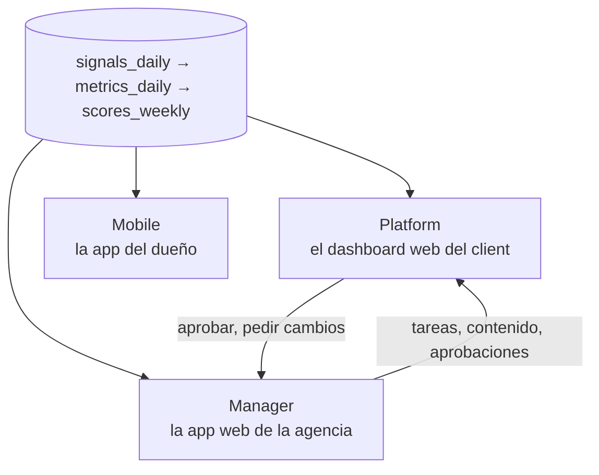

# Tres superficies, *un solo modelo de datos*

Todos leen los mismos números de las mismas tablas. Lo que cambia es quién mira y qué puede hacer.

| Superficie | Audiencia | Qué es | Construida en |
| --- | --- | --- | --- |
| [Platform](./platform) | Dueño y personal del restaurante | El Growth OS: cinco engines, el Growth Score, atribución, aprobaciones de contenido, benchmarks y reportes | Next.js |
| [Mobile](./mobile) | Dueño del restaurante | La app del dueño: feed en vivo, cinco engines, alcance, reseñas, guests y el equipo, en el bolsillo | Expo (React Native) |
| [Manager](./manager) | Equipo de Atrium | El Agency OS: salud de la cartera, workspaces por client, proyectos de entrega, tareas, pipeline de contenido, COG, aprobaciones, estado de datos | Next.js |

[Paquetes y acceso](./packages-and-access) controla qué secciones de la Platform y de Mobile están activas para cada client.

:::tip Qué está construido hoy
Las páginas de cada superficie describen el producto completo. Para lo que corre ahora, quién entra por dónde y el flujo de feedback del guest desde una orden hasta un caso resuelto, lee [Usar el sistema hoy](./using-the-system).
:::

## Reglas compartidas

- **Conteos antes que dólares.** La atribución empieza por los guests ganados; los dólares son el subproducto y cada uno lleva su método.
- **Cada número se juzga de tres maneras:** contra el período anterior, contra el radio de 10 millas (la marca ámbar) y sobre cualquier rango de fechas.
- **Cada número resuelve a una métrica** del [inventario](../data/metrics-and-scoring). Un número que no se puede rastrear hasta una fila no se publica.
- **Las páginas bloqueadas siguen visibles,** para que el client vea qué desbloquea el siguiente paquete.
- **Todo lo que habla por el client o gasta su dinero** pasa por una aprobación, en la misma cola de cada superficie.
