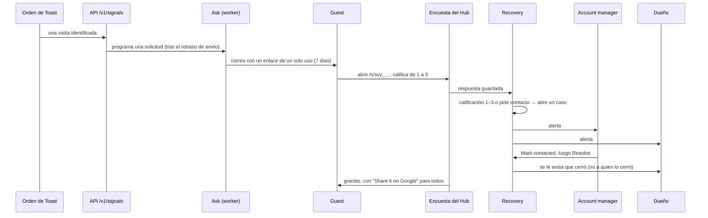

# Usar el sistema *hoy*

Las páginas de [Platform](./platform) y [Manager](./manager) describen el producto completo. Esta página describe lo que está **construido y corriendo** ahora, tal como se recorrió en un entorno vivo. Todo lo de aquí es el engine de Reputation y la carcasa que lo rodea; el resto de las secciones aparece en la navegación, bloqueado o como adelanto.

:::note Cómo se validó
El flujo se manejó de punta a punta contra un build local (API, worker, Platform, Manager y Hub con datos demo), con un navegador automatizado y una lectura de la base de datos después de cada paso. Nada de esta página sale de un mock. Mira [Desarrollo local](../guides/local-development) para repetirlo.
:::

## Quién entra por dónde

| Superficie | Puerto local | Quién | Qué hace |
| --- | --- | --- | --- |
| **Hub** | 3004 | El guest, sin cuenta | Abre un enlace de encuesta o un QR, responde y, si quiere, pide contacto. También es el formulario público de "solicitar acceso" |
| **Platform** | 3003 | El client: dueño y personal | Ve el feedback de sus propios lugares, comparte el QR y le pide ayuda al equipo de Atrium |
| **Manager** | 3002 | La agencia: account manager y equipo | Trabaja los casos de recuperación, configura formularios y QR por lugar, aprueba cuentas y lugares y responde las solicitudes de ayuda |
| **API** | 3001 | Las tres superficies y los conectores | Una sola API para todos; cada pantalla es cliente de ella |

El acceso a Platform y Manager es con correo y contraseña. Un client entra por el [alta](#dar-de-alta-a-un-client): el dueño pide acceso en el Hub, la agencia aprueba y el dueño define su contraseña.

## El flujo principal: de una orden a un caso resuelto

Qué hace cada paso, tal como se observó:

1. **Llega una orden** por la API de ingesta, con el guest identificado. Ask programa una solicitud de reseña para ese guest, con el *Send delay* del lugar (0 minutos por defecto). El worker la envía en el siguiente minuto.
2. **El guest recibe un correo** con el nombre del lugar y un enlace `…/s/svy_…`. El enlace funciona **una sola vez** y vence en 7 días; abrirlo de nuevo responde `410`.
3. **La encuesta** muestra una escala de emojis de 1 a 5. Desde 4 pregunta *What was best?*; con 3 o menos pregunta *What should we improve?* (Food, Service, Atmosphere, Value, Speed, Cleanliness, Nothing). El comentario libre es opcional. Un interruptor, *I would like someone to contact me*, muestra nombre, correo y teléfono: el formulario no se envía hasta que haya un correo o un teléfono.
4. **La pantalla de gracias** siempre ofrece **Share it on Google**, sin importar la calificación. Es una regla, no una opción: [ADR 0018](../adr/0018-no-review-gating).
5. **Recovery abre un caso** cuando la calificación es 1–3 o el guest pide contacto. Un 2 con contacto abrió un caso `medium` con plazo de 1 día. La severidad solo sube si una lectura lo indica ([Leer las palabras de los guests](../modules/reputation#leer-las-palabras-de-los-guests)).
6. **Se avisa al equipo**: una notificación por destinatario, al dueño en la Platform y al account manager en el Manager, en la campana de notificaciones y por correo (tipo `reputation.case_alert`). Un caso que luego sube a una severidad mayor avisa de nuevo.
7. **El account manager trabaja el caso**: lo abre, lee el comentario y el contacto, usa **Mark contacted** y luego **Resolve**, con una nota opcional para el registro. **Mark contacted** no avisa a nadie. **Resolve** emite `recovery.case.resolved` y notifica a los dueños y al equipo asignado, salvo a quien lo resolvió (tipo `reputation.case_resolved`). Así la gente se entera dos veces de un caso: cuando abre o sube de severidad, y cuando cierra.

8. **Todo queda auditado**: el envío de Ask, la clasificación de Recovery y la apertura del caso dejan cada uno una fila en el registro de auditoría con el agente que actuó.

## Qué ve cada rol

### Guest (Hub)

La encuesta, la pantalla de gracias y el formulario *Request access* para un negocio nuevo. La página de inicio del Hub es un estado vacío ("Nothing here") que lleva a ese formulario. Sin cuenta y sin navegación.

### Dueño del client (Platform)

| Área | Qué contiene |
| --- | --- |
| **Overview** | Casos abiertos, casos pasados del plazo de 24 horas, respuestas de la semana |
| **Reputation → Feedback** | Los casos de recuperación de los lugares del client, filtrados por estado, con severidad y cuánto lleva cada uno esperando |
| **Reputation → Responses** | Lo que respondieron los guests, con un filtro de 3 estrellas o menos y un botón para preguntarle al equipo de Atrium por una respuesta |
| **Reputation → QR & links** | El QR impreso de cada lugar (copiar, vista previa), el enlace de reseña de Google (solo lectura: *only the Atrium team can change this*), el retraso de envío y **Generate link** para un enlace de un solo uso |
| **My places** | Los lugares y su estado; un lugar nuevo se pide aquí y lo aprueba la agencia |
| **Help** | Una conversación con el equipo de Atrium: elige un lugar, di qué necesitas y sigue el hilo. Mira [Pedidos de ayuda como conversaciones](../modules/reputation#pedidos-de-ayuda-como-conversaciones) |
| **Notifications** | Lo que necesita al dueño y lo que se decidió, con marcar todo como leído |
| **Modules** | Content, Analytics, Discoverability, Attribution, Growth y Management abren como adelanto. **Retention** y **Benchmarks** muestran un candado, según el [paquete](./packages-and-access) del client |

### Account manager (Manager)

| Área | Qué contiene |
| --- | --- |
| **Overview** | Toda la cartera: casos pasados del plazo, casos abiertos, cuentas y lugares esperando aprobación |
| **Reputation → Cases** | Los casos de todos los clients, con un panel de detalle: calificación, qué mejorar, lo que escribió el guest, cómo contactarlo, una nota y los botones de estado |
| **Reputation → Responses** | Todas las respuestas con insignias: *Link*, *QR*, *Wants contact*, *Recovery case* |
| **Reputation → Forms & QR** | Por lugar: QR (copiar, vista previa, **Rotate QR**), el enlace de reseña de Google, el retraso de envío y enlaces de un solo uso. Solo la agencia puede editar el enlace de reseña |
| **Reputation → Help requests** | Los hilos de los clients, respondidos en la misma conversación |
| **Approvals** | Cuentas y lugares esperando el visto bueno de la agencia |
| **Clients → Places** | Todos los lugares de todos los clients, esperando o activos, con **Pause** |
| **Notifications** | La misma campana, con las alertas de la agencia |

## Dar de alta a un client

1. El dueño llena **Request access** en el Hub (negocio, dueño, correo, primer lugar, zona horaria, una nota). El formulario siempre responde `202`, así nadie puede saber qué correos existen, y tiene límite de frecuencia.
2. La solicitud aparece en el Manager en **Approvals → Accounts**. La agencia aprueba o rechaza.
3. Al aprobar, el sistema crea el client y su organización, convierte al dueño en `client_owner`, asigna el client al aprobador cuando es un account manager y emite un **enlace para definir contraseña**. El dueño la define en la Platform y entra.
4. Un lugar nuevo se pide desde **My places** y se aprueba en **Approvals → Places** antes de que Ask pueda usarlo.

## Lo que todavía no está construido

La navegación muestra todo el producto a propósito, para que un client vea qué desbloquea el siguiente paquete. Hoy solo esto está vivo:

| Vivo | Visible pero sin construir |
| --- | --- |
| Encuesta del guest, QR y enlaces de un solo uso | Growth Score, el mapa, las pantallas de scores y métricas |
| Ask: solicitudes de reseña desde una orden | El contenido de Discoverability, Attention, Retention, Growth, Attribution y Benchmarks |
| Casos de recuperación y sus alertas | Proyectos, tareas, pipeline de contenido, COG y registro diario en el Manager |
| Solicitudes de ayuda como conversaciones | La app móvil |
| Notificaciones, aprobaciones y lugares | Reportes |
| Lectura de Sentiment, **solo si hay un modelo configurado** | |

Sin modelo, Sentiment queda apagado al arrancar y su llamada a la herramienta se registra como `rejected` en el registro de auditoría. Los casos se abren igual por la calificación, como dice la página de [Reputation](../modules/reputation).
