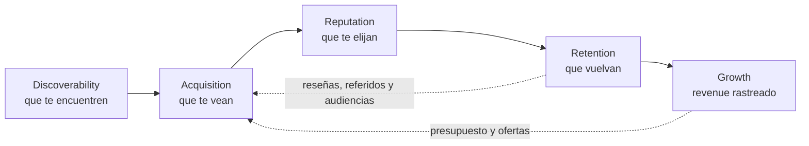

# El Growth System, en *una página*

El Growth System es la forma en que Atrium hace crecer un restaurante: **cinco engines**, cada uno dueño de una pregunta, todos medidos por la misma cadena de datos (signal → metric → score) y combinados en un solo número, el **Growth Score**. Esta documentación es la fuente única de verdad para la agencia y para la plataforma que la opera.

:::info Regla de la documentación
Si un nombre, una métrica o un umbral no está aquí, no se usa en código, reportes ni ventas. Si hace falta uno nuevo, se agrega aquí primero.
:::

## Tres problemas, cinco engines

| Problema | Lo que dice el dueño | Engines | Etapas del recorrido |
| --- | --- | --- | --- |
| Invisibilidad | "No saben que existimos" | [Discoverability](./engines#discoverability) · [Acquisition](./engines#acquisition) | Stranger → Discovery |
| Confianza | "Nos encuentran pero no nos eligen" | [Reputation](./engines#reputation) | Consideration → First Visit |
| Retención | "Vinieron una vez y no volvieron" | [Retention](./engines#retention) · [Growth](./engines#growth) | First Visit → Loyal Regular |

## Un solo número

Cada engine recibe un score de 0 a 100: 60% medido contra el radio de 10 millas del propio restaurante y 40% juzgado contra una rúbrica de práctica. Los cinco scores suman el **Growth Score, 0–300**. Ver [Métricas y Growth Score](./metrics).

## Cómo leer esta documentación

- **[Sistema](./glossary)**: el modelo de negocio. Glosario, engines, recorrido del cliente, servicios y paquetes, métricas, riesgos.
- **[Agentes](../agents)**: cada engine convertido en un agente con subagentes, autonomía y reglas.
- **[Datos](../data)**: cómo se produce cada número: signals, fuentes, métricas, scores, almacenamiento.
- **[Producto](../product)**: las tres superficies que usa la gente: Platform, Manager y Mobile.
- **[Arquitectura](../architecture)**: cómo está construida la plataforma y por qué.
- **[Módulos](../modules)**: la especificación de cada módulo.
- **[Plan](../plan)**: fases, puertas, pruebas y decisiones abiertas.
- **[Decisiones](../adr)**: cada decisión técnica importante, con su contexto.
- **[Guías](../guides)**: cómo trabajar en el repositorio.
