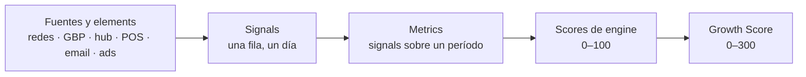

# Métricas y el *Growth Score*

Todo lo que muestra una pantalla es matemática sobre una sola cosa atómica: una **signal** con sello diario. Las métricas se construyen a partir de signals, cada engine mezcla medido y práctica en un score y los cinco scores se convierten en el **Growth Score**. El inventario completo de métricas vive en [Métricas y scoring](../data/metrics-and-scoring); esta página es el modelo.

## De signal a score



## El score

```text
engine score  = 0.6 × measured + 0.4 × practice
measured      = promedio de las métricas del engine de  min(tú ÷ benchmark, 2) ÷ 2 × 100
practice      = criterios calificados de 0 a 4 por agentes con una rúbrica fija, normalizados a 0–100
Growth Score  = 0.6 × (Discoverability + Acquisition + Reputation + Retention + Growth)   → 0–300
```

- El **benchmark** es el promedio de los restaurantes en un radio de 10 millas, por métrica, mensual. Una métrica sin benchmark igual se muestra, solo que sin la marca ámbar, y queda fuera de la mitad medida.
- Los criterios de **practice** son cosas que ninguna API reporta (consistencia de publicación, calidad de respuestas, higiene de la lista). Se califican cada semana y se escriben en `agent_grades`; el Account Manager puede corregir una nota con un comentario.
- Los **pesos** son editables por engine; los de arriba son la propuesta inicial y se calibran con los primeros 5 clients.
- El Growth Score se muestra junto a la misma mezcla del radio de 10 millas, así que cada número se juzga de tres maneras: contra el período anterior, contra el radio y sobre cualquier rango de fechas.

## Colores

Cada score de engine usa una sola regla en todas partes: **80+ verde, 60–79 ámbar, menos de 60 rojo**. El Growth Score usa los mismos umbrales escalados a 300 (240 y 180).

## Reglas de las métricas

1. Un solo nombre por métrica. La etiqueta canónica está a la izquierda del [vocabulario](../data/metrics-and-scoring#un-solo-nombre-por-métrica); los sinónimos no se publican nunca.
2. Cada métrica tiene una unidad fija, una fórmula sobre signals, una etapa del funnel y un engine.
3. Una métrica estimada lo dice. Las ventas on-premise son órdenes cruzadas × ticket medio; nunca se presentan como verificadas.
4. La correlación temporal nunca se suma como revenue atribuido. Cada dólar atribuido muestra su método (pixel, código, teléfono o email de lealtad, cruce de tarjeta, manual).

## Economía: hipótesis a validar

```text
LTV = ticket medio × visitas por año × años de relación = 28 × 6 × 5 = 840
```

| Supuesto | Valor | Cómo se valida |
| --- | --- | --- |
| Ticket medio | $28 | Resumen de ventas de Toast o el dueño, por client |
| Visitas por año | 6 | Visitas repetidas de guests identificados en 12 meses |
| Años de relación | 5 | Curvas de retención por cohorte |
| Costo de un guest nuevo vía paid | $5–20 | Inversión en ads / guests nuevos atribuidos |
| Costo de reactivar un guest | $1–5 | Costo de envíos / guests reactivados |
| Tasa de visita (estimación manual) | 0.30 de las intent actions se vuelven visita | Se mantiene salvo que el Account Manager fije otra por client |

Estas cifras solo se usan en ventas con datos reales de al menos un client, o presentadas como estimación.

### Principios detrás de los números

- **El principio de la lista corta.** Los guests eligen de una lista mental de 3–5. Todo el sistema existe para entrar en ella antes de que llegue el hambre.
- **Mera exposición.** 1–2 vistas: awareness. 3–10: familiaridad. 10+: preferencia, recordada sin ayuda. Un calendario constante le gana a cualquier publicación viral.
- **Credibilidad de las reseñas.** Rating × volumen × recencia. Un 4.5★ con 2,500 reseñas le gana a un 4.8★ con 40.
- **Retención vs adquisición.** Guest nuevo vía paid: $5–20. Guest dormido reactivado: $1–5. Guest activo por email: centavos.
- **Alcance propio vs alquilado.** 5,000 contactos propios valen más que 50,000 seguidores; las plataformas se alquilan, una base de datos es tuya.
